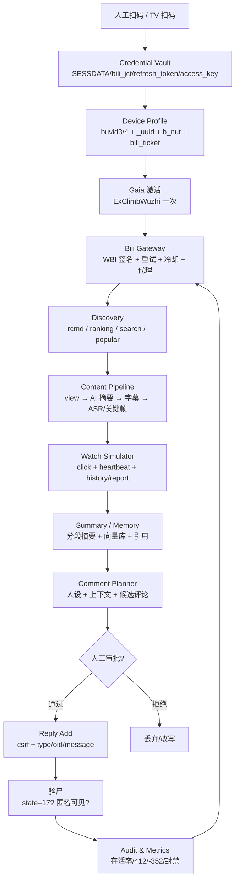

# B站 AI Bot 技术调研：自动刷视频、发评论的底层逻辑（2025–2026）

> **调研时间**：2026-10-21（Asia/Shanghai）
> **对象**：bilibili.com Web 端、App 端私有接口，以及官方开放平台
> **方法**：① 抓取/克隆 2026-01 的 API 文档快照与 2026-10 的在维护项目源码；② 阅读 BiliBiliToolPro、biliup、OpenBiliClaw 等实现；③ 2026-10-21 做了一组低量匿名探针（7 个 GET，无 Cookie，3 秒间隔）；④ 交叉核对 2025–2026 的公开文章与项目公告。
> **重要前提**：本文是**技术风险调研**，不是“绕过平台风控的教程”。B站用户协议禁止未经授权的自动化访问、刷量与虚假互动；2026 年已出现律师函清库事件。真正要落地“AI 陪伴”，应把**读**与**写**分开、把**自动**与**人工审批**分开，并准备随时停用。

---

## 0. 结论先行（TL;DR）

1. **B站没有“AI 陪伴/自动观看/自动评论”的官方 API。** 官方开放平台（openhome.bilibili.com / open-live.bilibili.com）主要覆盖**视频稿件投稿**与**直播**，不提供首页推荐流、观看上报、评论、动态发布能力；想实现只能在 Web/App 私有接口上做。
2. **身份不是“一个 SESSDATA”这么简单，而是“账号 + 设备档案 + 出口 IP + 行为节奏”四件套。** 其中 `buvid3/buvid4/_uuid/b_nut` 必须长期稳定；程序新生成的 buvid 若不经过 `ExClimbWuzhi` 建立服务端设备档案，分享、投币等接口会概率性 `-403`。BiliBiliToolPro 在 2026-09-15 的生产验证明确记录了这一点。
3. **WBI 是“风控层”而不是“硬鉴权层”。** 签名缺失/错误在低风险匿名请求下可能被放行；在登录态、高频、特定接口（如 `reply/wbi/main`、`search/type`、`playurl`）下会返回 `-352`/`v_voucher`，甚至 `-403`。2026-10-21 的匿名实测中，`/x/web-interface/view`、`ranking/v2`、`rcmd` 不带 WBI 仍返回 `code=0`；但 BiliBiliToolPro 2026-09 的注释称登录态下裸 `view` 已会 `-412`，说明**强制程度是灰度/条件性的**，生产端应默认签名。
4. **“刷视频”要拆成三件事**：
   - **内容获取**（元数据/字幕/AI 摘要/弹幕/评论）——可以完全不“播放”；
   - **观看历史与推荐画像**（`click` + `heartbeat` + `history/report`）——影响“这个账号看到什么”；
   - **播放量**（`click` + 去重 + App 加密上报）——这是反作弊主战场，**AI 陪伴不需要，也不建议做**。
5. **评论/动态是最高风险的写操作。** 评论有独立内容审核（社区俗称“阿瓦隆”）：先审后发、秒删、Shadowban（`state=17`）、折叠；动态发布要求绑定手机（`4126021`），且是公开广播。封禁原因里明确有“刷屏/抢楼/垃圾广告/引战”等。
6. **对“每天 20 个视频、总结、偶尔一条评论”的目标，推荐架构是**：独立小号 + 固定设备指纹 + 固定家宽/粘性住宅 IP + 读多写少 + 评论人工审批 + 风控 Governor + “AI 摘要/字幕优先”的内容管线。**不要**做播放量、不要自动过极验、不要批量关注/评论。

---

## 1. 三条技术链路：先选“身份”，再谈“能力”

B站同一账号可以同时存在多套凭证。对 Bot 来说，首要决策不是“用哪个接口”，而是“用哪套身份”。

| 链路 | 典型凭证 | 能做什么 | 优点 | 代价/限制 | 关键端点 |
|---|---|---|---|---|---|
| **Web Cookie** | `SESSDATA` + `bili_jct` + `DedeUserID` + `buvid3/4` | 推荐流、搜索、播放、点赞/投币/收藏/关注、评论、动态、上传 | 能力最全；文档/社区实现最多 | Cookie 约 180 天；敏感接口会加速失效；`refresh_token` 流程复杂；Web 端 WBI/风控最密 | `passport.bilibili.com/x/passport-login/web/*` |
| **App access_key** | `access_key` + `appkey`/`sign` + 设备头 | 推荐流、播放、部分写操作 | Token 有效期长（TV 登录 180 天，可 refresh）；App 接口风控参数与 Web 不同 | 需要完整设备指纹与 protobuf 头；播放上报是加密的；逆向成本高 | `passport.bilibili.com/x/passport-tv-login/*`、`app.bilibili.com/*` |
| **TV/OAuth** | TV 扫码得到的 `access_token` + `refresh_token` | 以 App 身份调用；可长期续期 | 最适合“长期挂机账号”的登录态 | 需要 TV appkey 签名；部分 Web 写接口不认 access_key | `x/passport-tv-login/qrcode/auth_code`、`.../poll` |
| **官方开放平台** | OAuth `access_token` | 视频稿件投稿、直播相关 | 合规、稳定、有文档 | **没有**推荐流/观看/评论/动态；能力边界很窄 | `openhome.bilibili.com/doc`、`open-live.bilibili.com/document/` |

> 官方开放平台的示例仓库 `bilibili-openplatform/demo` 已于 2024-11-06 归档，README 明确“目前主要包含视频稿件投稿流程的各语言版本示例代码”。这说明开放平台的定位是**创作端**，不是消费端/互动端。

**现实选择**：
- 要“看视频 + 总结”：**Web Cookie 足够**，因为读接口最全、调试最快。
- 要“长期稳定登录 + 少写”：**TV 扫码拿 access_key/refresh_token** 更稳，但写评论仍建议回 Web Cookie（带 `bili_jct`）。
- 要“评论/动态”：**只能用 Web Cookie**（App access_key 也能评论，但需要 App 签名与设备头，性价比低）。
- 要“合规”：**只有开放平台**，但它做不了 AI 陪伴。

---

## 2. 登录与身份

### 2.1 Web 扫码登录（最稳、最推荐）

流程（二维码 180 秒有效）：

1. `GET https://passport.bilibili.com/x/passport-login/web/qrcode/generate`
   - 返回 `data.url`（二维码内容）与 `data.qrcode_key`（32 字符）。
2. 轮询 `GET https://passport.bilibili.com/x/passport-login/web/qrcode/poll?qrcode_key=...`
   - `data.code`：`0` 成功；`86101` 未扫码；`86090` 已扫码未确认；`86038` 二维码失效。
   - 成功时 `Set-Cookie` 写入：`SESSDATA`、`bili_jct`、`DedeUserID`、`DedeUserID__ckMd5`、`sid`。
   - 同时返回 `refresh_token`（需要持久化，用于后续 Cookie 刷新）。
3. 用 `GET https://api.bilibili.com/x/web-interface/nav` 验证：`code=0` 且 `data.isLogin=true`。

**Cookie 生命周期（观察值）**：文档中的 `Set-Cookie` 显示 `SESSDATA` 约 **180 天**（2022-09-05 → 2023-03-04；2023-05-19 刷新后 → 2023-11-15）。但**敏感接口访问、异地登录、风控命中会提前失效**，所以不能把 180 天当保证。

> 来源：[二维码登录（BAC 镜像，2025-11-16 更新）](https://tc999.github.io/bilibili-API-collect/docs/login/login_action/QR.html)

### 2.2 密码登录 / 短信登录（会遇极验）

这两条路都**必须先过人机验证**（目前是极验 geetest），不适合无人值守的首次登录；更适合“人工过一次，之后用 Cookie/refresh_token 续命”。

**密码登录**：

1. `GET https://passport.bilibili.com/x/passport-login/captcha?source=main_web`
   - 返回 `data.type=geetest`、`data.token`、`data.geetest.gt`、`data.geetest.challenge`。
2. 前端完成极验，得到 `validate` 与 `seccode`（`seccode` 通常为 `validate|jordan`）。
3. `GET https://passport.bilibili.com/x/passport-login/web/key` 取 RSA 公钥与 `hash`；密码加密方式为 `RSA(hash + password)`，Base64。
4. `POST https://passport.bilibili.com/x/passport-login/web/login`
   - 表单：`username`、`password`（加密后）、`keep=0`、`token`、`challenge`、`validate`、`seccode`、`source=main_web`。
   - 返回码：`0` 成功；`-629` 账号或密码错误；`-105` 验证码错误；`-2100` **需验证手机号或邮箱**（异地/新设备最常见）；`86000` RSA 解密失败。

**短信登录**：

1. `POST https://passport.bilibili.com/x/passport-login/web/sms/send`（`tel`、`cid`、`token`、`challenge`、`validate`、`seccode`）。
2. `POST https://passport.bilibili.com/x/passport-login/web/login/sms`
   - 表单：`cid`、`tel`、`code`、`source=main_web`、`captcha_key`（上一步返回）、`keep`。
   - 返回码：`0` 成功；`1006` 验证码错误；`1007` 验证码过期。

> 来源：[密码登录](https://tc999.github.io/bilibili-API-collect/docs/login/login_action/password.html)、[短信登录](https://tc999.github.io/bilibili-API-collect/docs/login/login_action/SMS.html)

**`-2100` 的现实含义**：账号被判定“登录环境有风险”，必须走手机号/邮箱二次验证。对应流程在 `password.md` 的“手机号验证”一节：`/x/safecenter/captcha/pre` → `/x/safecenter/common/sms/send` → `/x/safecenter/login/tel/verify` → `/x/passport-login/web/exchange_cookie`。**这条链路需要真人收短信**，Bot 不应尝试自动绕过。

### 2.3 TV 扫码登录（长期挂机首选）

TV 端扫码的价值：**一次扫码，拿到 180 天有效的 `access_token` + `refresh_token`**，不用维护 Web Cookie 的复杂刷新。

1. `POST https://passport.bilibili.com/x/passport-tv-login/qrcode/auth_code`
   - 表单：`appkey=4409e2ce8ffd12b8`、`local_id=0`、`ts`、`sign`（appkey+appsec MD5）。
   - 返回 `data.url`、`data.auth_code`。
2. `POST https://passport.bilibili.com/x/passport-tv-login/qrcode/poll`
   - 表单：`appkey`、`auth_code`、`local_id=0`、`ts`、`sign`。
   - 返回 `data.access_token`、`data.refresh_token`、`data.expires_in=15552000`（180 天）、`data.cookie_info`。
   - 状态码：`86038` 失效、`86039` 未确认、`86090` 已扫码未确认。
3. 续期：`POST https://passport.bilibili.com/x/passport-login/oauth2/refresh_token`（`access_key`、`refresh_token`、`appkey`、`ts`、`sign`）。

> 来源：[TV 端扫码登录](https://tc999.github.io/bilibili-API-collect/docs/login/login_action/QR.html#tv端扫码登录)、biliup `credential.rs` 的 `renew_tokens()` 实现（[biliup master](https://github.com/biliup/biliup/blob/master/crates/biliup/src/uploader/credential.rs)）。

### 2.4 Cookie / 设备字段速查

| 字段 | 来源 | 作用 | 生命周期/备注 |
|---|---|---|---|
| `SESSDATA` | 登录成功 Set-Cookie | 账号会话主凭证（HttpOnly） | 约 180 天；可被风控提前失效 |
| `bili_jct` | 登录成功 Set-Cookie | CSRF Token，所有写操作必带 | 随 Cookie 刷新 |
| `DedeUserID` | 登录成功 Set-Cookie | 账号 mid | 长期 |
| `DedeUserID__ckMd5` | 登录成功 Set-Cookie | 设备/账号校验辅助 | 长期 |
| `sid` | 登录成功 Set-Cookie | 会话标识 | 可选 |
| `buvid3` | `/x/frontend/finger/spi` 的 `b_3`，或首页 Set-Cookie | 设备 ID（主） | 应长期固定；格式 `XXXXXXXX-...infoc` |
| `buvid4` | 同接口的 `b_4` | 设备 ID（辅） | 与 buvid3 成对 |
| `b_nut` | 首次访问首页 Set-Cookie | 首次访问时间戳 | 固定；与 buvid3 配套 |
| `_uuid` | 客户端生成/设备档案 | 设备 UUID，Gaia 档案的“已注册”标记 | 格式 `9-4-5-4-12` hex + 6 位数字 + `infoc` |
| `b_lsid` | 前端生成 | 会话级设备标识 | 可选；不要每次随机跳变 |
| `bili_ticket` | `GenWebTicket` 接口 | JWT 风控票 | 3 天（259200s），建议 2.5 天刷新 |
| `bili_ticket_expires` | 同上 | 过期时间戳 | 与 ticket 配套 |
| `buvid_fp` | 指纹上报后服务端下发 | 设备指纹摘要 | 可选；与 buvid 保持一致 |
| `x-bili-gaia-vtoken` | 过验证码后 | 风控验证通过凭证 | 短期；按接口需要携带 |

> 来源：[获取 buvid3/buvid4/b_nut](https://tc999.github.io/bilibili-API-collect/docs/misc/buvid3_4.html)、[bili_ticket](https://tc999.github.io/bilibili-API-collect/docs/misc/sign/bili_ticket.html)

### 2.5 Cookie 刷新（2023 年后的官方风控机制）

Web Cookie 不是“永久有效”。B站从 2023 年起引入 `refresh_token` + `refresh_csrf` 的刷新链：

1. `GET https://passport.bilibili.com/x/passport-login/web/cookie/info?csrf=...`
   - 返回 `data.refresh`（是否需要刷新）、`data.timestamp`。
2. 生成 `CorrespondPath`：把字符串 `refresh_{毫秒时间戳}` 用 **RSA-OAEP** 加密，密文转小写 Base16。
   - 公钥是 Web 端 wasm 里的固定 JWK（见文档）。
3. `GET https://www.bilibili.com/correspond/1/{correspondPath}`（需 Cookie）
   - 从 HTML 里提取 `refresh_csrf`。
4. `POST https://passport.bilibili.com/x/passport-login/web/cookie/refresh`
   - 表单：`csrf`、`refresh_csrf`、`source=main_web`、`refresh_token`。
   - 成功会 Set-Cookie 新的 `SESSDATA/bili_jct/...`，并返回**新的** `refresh_token`。
   - 错误：`86095` = `refresh_csrf` 错误或 `refresh_token` 与 Cookie 不匹配。
5. `POST https://passport.bilibili.com/x/passport-login/web/confirm/refresh`
   - 表单：`csrf`（新 Cookie 的）、`refresh_token`（**旧的**）。
   - 作用：让旧 refresh_token 对应的 Cookie 失效，完成“换票”。

**工程要点**：
- 刷新前必须保存旧 `refresh_token`，第 5 步用的是旧值，不是新值。
- 刷新是“原子换票”：新 Cookie 生效后，旧 Cookie 可能很快失效；多进程同时刷新会互相踢掉。**同一账号只允许一个 refresher**。
- 如果 `cookie/info` 返回 `-101`，说明 Cookie 已失效，只能重新扫码。

> 来源：[Web 端 Cookie 刷新](https://tc999.github.io/bilibili-API-collect/docs/login/cookie_refresh.html)

### 2.6 设备指纹：从 Cookie 到 Canvas/WebGL

B站的风控不是只看 Cookie，而是看“设备是否像一个真实、稳定、有历史的浏览器”。分层如下：

| 层级 | 内容 | 采集/校验点 | Bot 该怎么做 |
|---|---|---|---|
| L1 Cookie | `buvid3/4`、`b_nut`、`_uuid`、`bili_ticket` | 所有接口 | **固定不变**；不要每天重新 `finger/spi` |
| L2 请求头 | `UA`、`Referer`、`Origin`、`Accept-Language`、`Content-Type` | WBI/写接口 | 用真实 Chrome UA；`Referer` 必须是 `https://www.bilibili.com/` 或视频页 |
| L3 设备档案 | `ExClimbWuzhi` 的 `payload`：屏幕、Canvas/WebGL 尾串、时区、语言、插件、`spm` 等 | Gaia 网关 | 生成一次、上报一次，之后**保持稳定**；不要每次随机 |
| L4 行为 | 请求间隔、播放进度、点击/暂停、评论频率 | 风控模型 | 随机化但**有边界**；不要 7×24 匀速 |

**buvid 的生成与“激活”**：

- `GET https://api.bilibili.com/x/frontend/finger/spi` 返回 `b_3`（buvid3）、`b_4`（buvid4）。
- 但**新生成的 buvid 在服务端没有设备档案**。BiliBiliToolPro 的实测（2026-09-15）：
  - 直接使用程序生成的 buvid3，`share/add` 会概率性 `-403`（“账号异常”）；
  - 需要 `POST https://api.bilibili.com/x/internal/gaia-gateway/ExClimbWuzhi` 上报一次设备指纹，建立档案；
  - 请求头需 `Referer: https://www.bilibili.com/`、`Origin: https://www.bilibili.com`、与模板一致的 UA；
  - Body 是 `{"payload": "<JSON 字符串>"}`，Cookie 带 `buvid3/buvid4/b_nut/_uuid`；
  - 成功后把 `_uuid` 写入 Cookie，作为“已激活”标记；**之后不要每天刷新 buvid**，否则档案丢失、风控加重。

> 来源：[BiliBiliToolPro LoginDomainService.cs](https://github.com/RayWangQvQ/BiliBiliToolPro/blob/main/src/Ray.BiliBiliTool.DomainService/LoginDomainService.cs)（`EnsureDeviceCookieAsync`，注释明确“Verified against the production container on 2026-09-15”）、[IGaiaApi.cs](https://github.com/RayWangQvQ/BiliBiliToolPro/blob/main/src/Ray.BiliBiliTool.Agent/BiliBiliAgent/Interfaces/IGaiaApi.cs)

**Canvas/WebGL 指纹**：`ExClimbWuzhi` 的 payload 是一个大 JSON，里面 `3c43` 对象包含屏幕分辨率、UA、语言、时区、插件列表、Canvas 尾串（`13ab`/`bfe9`）等。BiliBiliToolPro 的做法是：用真实浏览器模板，替换时间戳、`_uuid`、`spm`，并对屏幕分辨率和 Canvas 尾串做**受控扰动**，避免多设备完全同指纹。对“单账号单设备”的 AI 陪伴，**不需要伪造多套指纹**，反而应固定一套。

**`b_lsid` / `buvid_fp`**：`b_lsid` 是前端生成的会话级 ID，`buvid_fp` 是服务端下发的指纹摘要。二者都不是所有接口的硬性要求；不要为了“更像浏览器”而每次随机，稳定比“齐全”更重要。

### 2.7 bili_ticket：3 天有效期的 JWT 风控票

`bili_ticket` 放在 Cookie 里，**非必需，但存在可降低风控概率**。它是 JWT（`alg=HS256, kid=s03`），有效 **259200 秒（3 天）**。

获取方式：

1. 取当前秒级时间戳 `ts`。
2. `hexsign = HMAC_SHA256(key="XgwSnGZ1p", msg="ts" + ts)`。
3. `POST https://api.bilibili.com/bapis/bilibili.api.ticket.v1.Ticket/GenWebTicket`
   - Query/Form：`key_id=ec02`、`hexsign`、`context[ts]=ts`、`csrf`（可空）。
   - Header：`Referer` 为空或 `.bilibili.com` 子域。
4. 返回 `data.ticket`、`data.created_at`、`data.ttl=259200`、`data.nav.img/sub`（可复用为 WBI key）。

**工程要点**：每 2–2.5 天刷新一次；把 `bili_ticket` 和 `bili_ticket_expires` 一起写入 Cookie；如果 `GenWebTicket` 返回 `400`，先检查 `hexsign` 的 HMAC key 与时间戳是否一致。

> 来源：[BiliTicket（BAC 镜像）](https://tc999.github.io/bilibili-API-collect/docs/misc/sign/bili_ticket.html)

### 2.8 账号安全：异地登录、设备管理、小号/大号

- **异地/新设备**：最常见的表现是登录接口 `-2100`（需手机号/邮箱验证），或直接触发极验。B站没有面向开发者的“设备锁 API”，但 App 内有登录保护/设备管理；服务端会按 `mid + buvid + IP + UA` 记登录记录。
- **登录记录可自查**：
  - `GET https://api.bilibili.com/x/safecenter/login_notice?mid=...&buvid=...`
  - `GET https://api.bilibili.com/x/member/web/login/log`
  - 返回 `device_name`、`login_type`、`login_time`、`location`、`ip`（部分打码）。Bot 上线后应每日核对，出现陌生设备立即停用。
- **小号 vs 大号**：

| 维度 | 主号 | 小号 |
|---|---|---|
| 推荐画像价值 | 高（有历史/关注/收藏） | 低（冷启动，推荐不准） |
| 封号损失 | 极高（社交关系、收藏、创作内容、实名信息） | 低（可替换） |
| 写操作风险 | 不建议 | 可承受 |
| 账号条件 | 通常已绑手机、等级高 | 需养号：绑定手机、完善资料、稳定登录 2–4 周 |
| 建议 | **只读**；评论一律人工确认 | 承担“看+总结+少量评论”；仍要控制频率 |

**现实建议**：
- 如果“AI 陪伴”要长期存在，**主号只读，写操作走小号**；主号的推荐流可以通过“分享/收藏到小号”间接利用，但不要在主号上跑自动化写操作。
- 小号不要“当天注册当天评论”。先稳定登录、看视频、完善资料 2–4 周，再逐步增加互动。
- 不要多账号共用同一 `buvid`/`_uuid`/IP；一号一设备一 IP，至少做到“一号一 IP 段”。

---

## 3. WBI 签名与请求链路

### 3.1 WBI 算法（2023-03 起）

WBI 是 Web 端部分接口的查询参数签名：在原始 Query 上追加 `wts`（秒级时间戳）与 `w_rid`（MD5）。

**步骤**：

1. 从 `GET https://api.bilibili.com/x/web-interface/nav` 的 `data.wbi_img.img_url/sub_url` 取文件名（去掉 `.png`），得到 `img_key`、`sub_key`。未登录时 `code=-101`，但**仍会返回这两个 key**。
   - 也可从 `GenWebTicket` 的 `data.nav.img/sub` 获取。
2. `raw = img_key + sub_key`，按 64 项重排表取前 32 位，得到 `mixin_key`：
   ```
   46,47,18,2,53,8,23,32,15,50,10,31,58,3,45,35,27,43,5,49,
   33,9,42,19,29,28,14,39,12,38,41,13,37,48,7,16,24,55,40,
   61,26,17,0,1,60,51,30,4,22,25,54,21,56,59,6,63,57,62,11,
   36,20,34,44,52
   ```
3. 参数处理：
   - 加 `wts = int(time.time())`；
   - 按 key 升序排序；
   - 过滤 value 中的 `!'()*` 五个字符；
   - 用 `encodeURIComponent` 规则编码（空格 `%20`，字母大写）；
   - `w_rid = md5(query + mixin_key)`；
   - 把 `w_rid`、`wts` 追加到原 Query。

**Python 最小实现**：

```python
import hashlib, time, urllib.parse

TAB = [46,47,18,2,53,8,23,32,15,50,10,31,58,3,45,35,27,43,5,49,
       33,9,42,19,29,28,14,39,12,38,41,13,37,48,7,16,24,55,40,
       61,26,17,0,1,60,51,30,4,22,25,54,21,56,59,6,63,57,62,11,
       36,20,34,44,52]

def wbi(params: dict, img_key: str, sub_key: str) -> str:
    mixin = "".join((img_key + sub_key)[i] for i in TAB)[:32]
    p = {k: "".join(c for c in str(v) if c not in "!'()*") for k, v in params.items()}
    p["wts"] = int(time.time())
    q = "&".join(f"{urllib.parse.quote(k, safe='')}={urllib.parse.quote(v, safe='')}"
                 for k, v in sorted(p.items()))
    return q + "&w_rid=" + hashlib.md5((q + mixin).encode()).hexdigest()
```

> 来源：[WBI 签名（BAC 镜像）](https://tc999.github.io/bilibili-API-collect/docs/misc/sign/wbi.html)

### 3.2 key 的缓存与刷新：文档说“每日更替”，实测可能长期固定

- 文档称 `img_key/sub_key` 全站统一、**每日更替**，建议缓存并刷新。
- **本次实测（2026-10-21）**：匿名 `nav` 返回的仍是 `7cd084941338484aae1ad9425b84077c` / `4932caff0ff746eab6f01bf08b70ac45`，与 2023 年文档示例完全相同。说明**至少在当前阶段没有每日轮换**，或者按需轮换、长期不变。
- 工程上仍应：
  - 缓存 5–30 分钟（OpenBiliClaw 用 300 秒）；
  - 遇到 `-352`/`v_voucher`/`-403` 时强制刷新 key 并重签一次；
  - 不要把 key 硬编码进生产代码（文档也提到部分 JS 硬编码，但那不代表稳定）。

> 本次实测脚本：`research/probe_bili.py`；结果：`research/probe-2026-10-21.json`。

### 3.3 哪些接口需要 WBI（按 2026-01 文档与 2026-10 代码）

| 接口 | 方法/端 | WBI 要求 | 说明 |
|---|---|---|---|
| `/x/web-interface/wbi/index/top/feed/rcmd` | GET / Web | 文档标“非必要”，实际建议签 | 首页推荐；`ps` 最大 30 |
| `/x/web-interface/wbi/search/type` | GET / Web | **强要求** | 搜索；`search_type=video`、`keyword`、`page`、`page_size` |
| `/x/space/wbi/acc/info` | GET / Web | **强要求** | UP 主信息 |
| `/x/space/wbi/arc/search` | GET / Web | **强要求** | UP 主投稿列表 |
| `/x/player/wbi/playurl` | GET / Web | **强要求** | 取视频流；登录才可 720P+ |
| `/x/player/wbi/v2` | GET / Web | 建议签 | 播放器元数据/字幕/在线人数 |
| `/x/web-interface/wbi/view` | GET / Web | 建议签（2026 起生产必签） | 视频详情；BiliBiliToolPro 注释称裸 `view` 会 `-412` |
| `/x/v2/reply/wbi/main` | GET / Web | **强要求** | 评论懒加载；签名错误返回 `-403` 而非 `-352` |
| `/x/web-interface/view/conclusion/get` | GET / Web | **强要求** | B站 AI 视频摘要（summary/outline/subtitle） |
| `/x/web-interface/ranking/v2` | GET / Web | 文档标“非必要” | 排行榜；建议签 |
| `/x/web-interface/popular` | GET / Web | 非必要 | 热门；带 Cookie 时排行个性化 |
| `/x/v2/reply` | GET / Web | 非必要 | 传统翻页评论 |
| `/x/v2/history/report` | POST / Web/App | 非必要 | 观看进度上报 |
| `/x/click-interface/web/heartbeat` | POST / Web | 非必要 | 播放心跳（web） |
| `/x/click-interface/click/web/h5` | POST / Web | 非必要 | 点击上报（播放量） |

**结论**：不要把“文档标非必要”理解为“不用签”。在登录态、高频、批量场景下，**统一签名**是最省心的策略；代价只是几十毫秒的 MD5。

### 3.4 请求头：Web 与 App 是两套语言

**Web 端（绝大多数读/写接口）**：

| Header | 建议值 | 说明 |
|---|---|---|
| `User-Agent` | 真实 Chrome/Edge UA，与设备档案一致 | 不要用 `curl/python/awa` 等敏感词 |
| `Referer` | `https://www.bilibili.com/` 或具体视频页 | 写接口/取流必需 |
| `Origin` | `https://www.bilibili.com` | POST 写接口建议带 |
| `Accept` | `application/json, text/plain, */*` | — |
| `Accept-Language` | `zh-CN,zh;q=0.9` | 与 `s_locale` 一致 |
| `Content-Type` | `application/x-www-form-urlencoded; charset=UTF-8` | POST 表单 |
| `Cookie` | 见 2.4 | 读接口也要带全 |
| `x-bili-device-req-json` | `{"platform":"web","device":"pc"}` | 部分动态/详情接口 |
| `x-bili-web-req-json` | `{"spm_id":"333.1368"}` | 部分动态/详情接口 |
| `x-bili-gaia-vtoken` | 过验证码后拿到的 `grisk_id` | 仅风控命中后需要 |

**App 端（`app.bilibili.com` / `api.bilibili.com` 的 App 接口）**：

| Header | 示例/说明 |
|---|---|
| `app-key` | `android64`（或对应 appkey） |
| `bili-http-engine` | `ignet` |
| `buvid` | 设备 buvid |
| `env` | `prod` |
| `fp_local` / `fp_remote` | 本地/远程设备指纹（64 位 hex 风格） |
| `guestid` | 游客 ID（未登录时） |
| `session_id` | 会话 ID |
| `x-bili-locale-bin` | Base64(protobuf `Locale`)：`c_locale/s_locale/timezone/utc_offset` |
| `x-bili-network-bin` | Base64(protobuf `Network`)：网络类型/质量 |
| `x-bili-ticket` | JWT，App 端身份票 |
| `x-bili-trace-id` | `base:sub:0:0` 格式的链路 ID |
| `x-bili-device-bin` | Base64(protobuf `bilibili.metadata.device.Device`)：`app_id/build/buvid/mobi_app/platform/device/channel/brand/model/osver/fp_local/fp_remote/version_name/fp/fts` |
| `x-bili-fawkes-req-bin` | Base64(protobuf `bilibili.metadata.fawkes.FawkesReq`)：`appkey`（如 `android64`）、`env=prod`、`session_id`（8 位 0-9a-z） |
| `x-bili-metadata-ip-region` | `CN` |

> 来源：[`bilibili.metadata.device` protobuf 定义](https://protodoc.io/aaa1115910/bv/bilibili.metadata.device)（字段注释明确“gRPC 头部：x-bili-device-bin”）、[fawkes.proto](https://gitea.s1f.ren/shiran/bilibili-API-collect/raw/commit/1817c58d0cf4586764fa517d36ba8a197634a286/grpc_api/bilibili/metadata/fawkes/fawkes.proto)、[APP API 签名](https://tc999.github.io/bilibili-API-collect/docs/misc/sign/APP.html)

**App 签名**：`appkey` + 参数按 key 排序 + URL Query + `appsec`，MD5 得到 `sign`；再带 `access_key`（登录态）、`ts`、`mobi_app`、`platform`、`build`、`buvid`、`session_id`。TV appkey 常用 `4409e2ce8ffd12b8`，Android appkey 常用 `1d8b6e7d45233436` / `783bbb7264451d82`（不同功能不同）。

### 3.5 WBI 强制程度：一次“矛盾”的实测

2026-10-21 20:42 CST，匿名、无 Cookie、单 IP、7 个请求，结果：

| 请求 | 是否带 WBI | HTTP | `code` | 说明 |
|---|---|---|---|---|
| `nav` | 否 | 200 | `-101` | 未登录，但返回 WBI key |
| `/x/web-interface/view?bvid=BV1xx411c7mD` | 否 | 200 | `0` | 裸 view 可用 |
| `/x/web-interface/view?bvid=...&w_rid=...` | 是 | 200 | `0` | 同样可用 |
| `/x/web-interface/wbi/index/top/feed/rcmd` | 否 | 200 | `0` | 未触发 `v_voucher` |
| `/x/web-interface/ranking/v2` | 否 | 200 | `0` | 返回 100 条 |
| `/x/player/wbi/v2`（带 WBI） | 是 | 200 | `0` | 该视频无字幕，`subtitles=[]` |
| `/x/v2/reply?type=1&oid=2` | 否 | 200 | `0` | 可读 |

但 BiliBiliToolPro 2026-09 的代码注释明确写：

> “B站已对 view 接口做 WBI 强制校验，未带 `w_rid/wts` 的请求会返回 `code=-412 (request was banned)`。此前该接口走非签名路径 `/x/web-interface/view`，在风控升级或请求量较大时会被拦截。这里改用 `/x/web-interface/wbi/view` 并携带 `wts`。”

**解释**：WBI 强制是**按账号/设备/IP/请求量/接口动态加码**的，不是全站开关。匿名低量请求可能被放行；登录态、云 IP、高频、特定 UA 会触发强制。**生产建议**：所有查询接口统一走 WBI 版本（`/wbi/view`、`/wbi/playurl`、`/wbi/search/type`、`/wbi/main`），不要赌“这次没签也过了”。

> 来源：[GetVideoDetailRequest.cs](https://github.com/RayWangQvQ/BiliBiliToolPro/blob/main/src/Ray.BiliBiliTool.Agent/BiliBiliAgent/Dtos/ApiApi/Video/GetVideoDetailRequest.cs)、[IApiApi.cs](https://github.com/RayWangQvQ/BiliBiliToolPro/blob/main/src/Ray.BiliBiliTool.Agent/BiliBiliAgent/Interfaces/IApiApi.cs)（`[Get("/x/web-interface/wbi/view")]`）

### 3.6 风控表现与返回码

| 表现 | 典型返回 | 含义 | 正确处理 |
|---|---|---|---|
| HTTP **412** | 空响应/HTML/`Precondition Failed` | IP/设备级封禁，常由高频/异常流量触发 | **全局暂停 10–30 分钟**，指数退避到 30 分钟；不要立刻换 IP 重试 |
| `code=-352` | `{"code":-352,"message":"风控校验失败","data":{"v_voucher":"voucher_..."}}` | 单接口风控挑战 | 先检查 WBI/UA/Referer/Cookie；必要时走 `v_voucher` → 极验；否则退避 3–5 分钟 |
| `code=-401` | `-401` | 未授权/Token 无效（部分 App 接口） | 重新登录/刷新 access_key |
| `code=-403` | `-403` | 权限不足/账号异常/WBI 错误（`reply/wbi/main`） | 区分：WBI 错误→重签；账号异常→停写 24h |
| `code=-101` | `-101` | 未登录/Cookie 失效 | 刷新 Cookie 或重新扫码 |
| `code=-102` | `-102` | 账号被封停 | 立即停用，人工申诉 |
| `code=-111` | `-111` | CSRF 校验失败 | 检查 `bili_jct` 与 Cookie 是否同步 |
| `code=-509` | `-509` | 请求过于频繁 | 退避 60s×N，降低并发 |
| `code=12015` | 评论 | 需要评论验证码 | 停评，人工处理 |
| `code=12016` | 评论 | 内容含敏感信息 | 改写/放弃，不要重试同文 |
| `code=12051` | 评论 | 重复评论/刷屏 | 去重，降频 |
| `code=4126021` | 动态 | 未绑定手机，无法发布 | 绑定手机或放弃动态 |
| `code=34004/34005` | 投币 | 投币间隔太短/超过上限 | 降频；每日限额 |
| `code=65006` | 点赞 | 重复点赞 | 幂等处理 |
| `code=22009` | 关注 | 已达关注上限 | 停止关注 |
| `code=86095` | Cookie 刷新 | refresh_csrf/token 不匹配 | 重新走刷新链，勿并发 |

> 来源：[v_voucher 验证](https://tc999.github.io/bilibili-API-collect/docs/misc/sign/v_voucher.html)、[评论操作错误码](https://tc999.github.io/bilibili-API-collect/docs/comment/action.html)、[动态发布](https://tc999.github.io/bilibili-API-collect/docs/dynamic/publish.html)、[点赞/投币/收藏](https://tc999.github.io/bilibili-API-collect/docs/video/action.html)

### 3.7 `v_voucher` → 极验 → `grisk_id` 的完整链

当接口返回 `-352` 且 `data.v_voucher`（或响应头 `x-bili-gaia-vvoucher`）存在时：

1. `POST https://api.bilibili.com/x/gaia-vgate/v1/register`
   - 表单：`v_voucher`、`csrf`（登录时）。
   - 返回 `data.type=geetest`、`data.token`、`data.geetest.gt/challenge`。
   - 同一 `v_voucher` 只能用一次，尽快验证。
2. 用极验 SDK 完成验证，得到 `validate`、`seccode`。
3. `POST https://api.bilibili.com/x/gaia-vgate/v1/validate`
   - 表单：`challenge`、`token`、`validate`、`seccode`、`csrf`。
   - 返回 `data.is_valid=1`、`data.grisk_id`（即 `gaia_vtoken`）。
4. 原请求 URL 加 `gaia_vtoken`，Cookie 加 `x-bili-gaia-vtoken`，重试。

**注意**：不是所有风控都能用验证码解除；`geetest=null` 时说明该风控无法通过 captcha 解除。**自动过极验**既违反平台规则，也会让账号进入更高风险池；AI 陪伴系统应当**停下来等人**。

> 来源：[v_voucher 验证](https://tc999.github.io/bilibili-API-collect/docs/misc/sign/v_voucher.html)、[申请 captcha](https://tc999.github.io/bilibili-API-collect/docs/login/login_action/readme.html)

### 3.8 IP / 代理策略：B站是“反向代理敏感”的

OpenBiliClaw 在 2026 年的代码里有一个非常实用的注释：

> “B站 is a CN domain: direct connection always works, while an inherited proxy ... routes through an exit IP that B站 risk-controls, showing logged-in users as 'not logged in'. Never inherit; `[bilibili].proxy` opts back in for networks that genuinely require one.”

实践建议：
- **首选**：国内家宽/固定公网 IP，一号一 IP；服务器直连（不要继承系统代理/Clash）。
- **次选**：粘性住宅代理（同一会话固定出口），不要每次请求轮换。
- **不要**：云厂商机房 IP 池、免费代理、公开 VPN、频繁切换国家/地区。
- 如果必须用代理，先做“登录态自检”：`nav` 返回 `isLogin=false` 而 Cookie 明明有效，通常是出口 IP 被风控。

> 来源：[OpenBiliClaw api.py](https://github.com/whiteguo233/OpenBiliClaw/blob/main/src/openbiliclaw/bilibili/api.py)（`trust_env=False` 注释）

---

## 4. “自动刷视频浏览”

### 4.1 发现内容：推荐流、排行榜、热门、分区、搜索

| 场景 | 端点 | 关键参数 | 返回要点 |
|---|---|---|---|
| 首页推荐（Web） | `GET /x/web-interface/wbi/index/top/feed/rcmd` | `fresh_type=4`、`ps`（≤30）、`fresh_idx`、`fresh_idx_1h`、`fetch_row`、`web_location=1430650` | `data.item[]`：`bvid`、`cid`、`id(aid)`、`title`、`duration`、`owner{mid,name}`、`stat{view,like,danmaku}`、`pic`、`pubdate`、`rcmd_reason` |
| 排行榜 | `GET /x/web-interface/ranking/v2` | `rid`（主分区 tid，0=全站）、`type=all/rookie/origin`、`web_location=333.934` | `data.list[]` 100 条，字段同视频详情 |
| 热门 | `GET /x/web-interface/popular` | `pn`、`ps` | `data.list[]`；带 Cookie 时排行个性化 |
| 分区/新番 | 分区动态、`/x/web-interface/dynamic/region` 等 | `rid`、`pn`、`ps` | 分区稿件 |
| 搜索 | `GET /x/web-interface/wbi/search/type` | `search_type=video`、`keyword`、`page`、`page_size`、`order`、`duration`、`tids` | `data.result[]`：`bvid`、`title`、`description`、`duration`、`author`、`play`、`pubdate` |
| App 推荐 | `GET https://app.bilibili.com/x/v2/feed/index` | `accessKey`（登录后个性化）、`mobi_app`、`platform`、`build`、`fnval` 等 | `data.items[]`：`param`(aid)、`title`、`cover`、`player_args`、`desc_button` |

**字段坑**：
- `rcmd` 文档里把 `duration` 拼成 `duraion`，实际返回是 `duration`；不要按文档字段名硬编码。
- `ranking/v2` 文档示例用 `tid`，但参数表写的是 `rid`；以 `rid` 为准。
- `rcmd` 的 `item[].goto` 可能是 `av`/`live`/`ogv`；只处理 `goto=="av"`，并过滤 `business_info`（广告）。
- `stat.view` 是展示值，不等于“你看了就 +1”。

> 来源：[视频推荐](https://tc999.github.io/bilibili-API-collect/docs/video/recommend.html)、[排行榜](https://tc999.github.io/bilibili-API-collect/docs/video_ranking/ranking.html)、[热门](https://tc999.github.io/bilibili-API-collect/docs/video_ranking/popular.html)、[App 推荐流](https://tc999.github.io/bilibili-API-collect/docs/video/recommend.html#获取短视频模式视频列表)

### 4.2 观看行为如何被记录：click、heartbeat、history

先纠正几个常见的“记忆端点”：

| 你可能会记成 | 2026 文档中的实际端点 | 端 |
|---|---|---|
| `/x/report/click/web/h5` | `POST /x/click-interface/click/web/h5` | Web |
| `/x/click-now/heartbeat` | `POST /x/click-interface/web/heartbeat` | Web |
| `/x/click-now/online` | `GET /x/player/online/total` | Web |
| `/x/click-now/...`（App） | `POST /x/report/click/android2`、`POST /x/report/heartbeat/mobile` | App |

**Web 端三条上报**：

1. **点击上报**：`POST https://api.bilibili.com/x/click-interface/click/web/h5`
   - 表单：`aid`、`cid`、`part`、`mid`、`lv`、`ftime`、`stime`、`type=3`、`sub_type=0`、`referer_url`、`outer=0`、`spmid`、`from_spmid`、`session`、`csrf`。
   - 文档明确：“该接口亦被用于计算播放量，播放量更新不是实时的；该接口使用似乎存在 200 播放限制，请勿滥用。”
2. **播放心跳**：`POST https://api.bilibili.com/x/click-interface/web/heartbeat`
   - 默认 15 秒一次，亦可记录播放历史。
   - 关键字段：`aid/bvid`、`cid`、`mid`、`played_time`（播放进度秒；播完为 `-1`）、`realtime`（本轮页面会话真实播放时间）、`real_played_time`、`video_duration`、`last_play_progress_time`、`max_play_progress_time`、`start_ts`、`type=3`、`sub_type=0`、`dt=2`、`play_type`（0 播放中/1 开始/2 暂停/3 继续/4 结束）、`csrf`。
   - WBI 参数 `w_rid/wts` 可选，但建议带。
3. **进度上报（双端）**：`POST https://api.bilibili.com/x/v2/history/report`
   - 表单：`aid`、`cid`、`progress`（秒）、`platform`、`csrf`。
   - 主要用于“观看历史/续播”，不直接等于播放量。

**一次“有效播放”到底怎么判定？**

平台没有公开公式，能确认的是：
- **`/x/web-interface/view` 不计播放**，它只是元数据接口；播放量来自播放器的 click/heartbeat 上报。
- 点击上报 + 心跳共同构成“观看”证据；只有 click 没有心跳，或心跳进度不连续，容易被判无效。
- 同一账号/设备对同一稿件的重复播放会去重；短时间反复刷同一视频，播放量不会线性增长。
- 播放量更新有延迟（文档明确“不是实时”）。
- Web 端 click 接口存在“200 播放限制”的社区观察；**刷量不是“多跑几次”那么简单**。

**App 端（另一套，且加密）**：

- `POST https://api.bilibili.com/x/report/click/android2`
- `POST https://api.bilibili.com/x/report/heartbeat/mobile`
- 请求体不是普通表单：`click/android2` 的 body 是 **AES-CBC 加密后的 hex**，明文为“表单 + `&sign=` + SHA256(表单+salt)”；同时需要一整套设备头（`x-bili-ticket`、`x-bili-device-bin`、`x-bili-locale-bin`、`x-bili-network-bin`、`fp_local/fp_remote/guestid/session_id` 等）。
- 公开逆向项目 `qiying123/Bilibili-api`（2025-11-03）复现了游客路径，其 README 的结论很关键：**“游客能增长的播放量每分钟在个位数；游客播放量有上限；加代理池增速也是个位数。”**

> **结论**：如果你要的是“AI 真的看了内容并理解”，**不需要**碰 App 加密上报；Web 的 click + heartbeat 足以让账号产生观看历史/画像。如果你要的是“刷播放量”，那是另一个高风险、低收益、且明确违反平台规则的领域，本文不建议继续。

> 来源：[视频观看数据上报](https://tc999.github.io/bilibili-API-collect/docs/video/report.html)、[qiying123/Bilibili-api](https://github.com/qiying123/Bilibili-api)

### 4.3 把“看视频”变成 LLM 能理解的内容

优先级从高到低：

| 来源 | 端点/方式 | 优点 | 局限 |
|---|---|---|---|
| **B站 AI 摘要** | `GET /x/web-interface/view/conclusion/get?bvid=&cid=&up_mid=&w_rid=&wts=` | 直接给 `summary`、`outline`（带时间戳）、AI 字幕分段；最省 token | 不是所有视频都有（`data.code=1` 无摘要）；需登录 + WBI；可能排队（`stid=0`） |
| **CC/AI 字幕** | `GET /x/player/wbi/v2?bvid=&cid=` → `data.subtitle.subtitles[].subtitle_url` | 原始逐句文本，可做 RAG/引用 | 未登录时 `subtitles=[]`；部分视频 `need_login_subtitle=true`；AI 字幕 URL 带 `auth_key` 会过期 |
| **ASR** | 下载 `playurl` 的音频流 → Whisper/Bcut | 覆盖无字幕视频 | 成本高、慢；需处理版权/存储 |
| **关键帧 + VLM** | `playurl` 视频流 → ffmpeg 抽帧 → 多模态模型 | 适合画面型内容（舞蹈/游戏/手工） | 成本最高；容易丢上下文 |
| **弹幕/评论** | `seg.so` 弹幕、`reply/main` 评论 | 反映“观众反应/梗/争议点” | 噪声大；不能当事实来源 |
| **元数据** | `view`/`rcmd` 的标题、简介、tag、UP、stat | 便宜、快 | 信息量有限，容易断章取义 |

**推荐管线**：

```
rcmd/search → 候选池
  → 规则过滤（时长、分区、广告、已看、敏感）
  → WBI view 取元数据（title/desc/tag/owner/stat）
  → 尝试 conclusion/get（AI 摘要+outline+字幕）
  → 没有摘要则 player/wbi/v2 取字幕
  → 没有字幕则下载音频做 ASR（仅对高价值视频）
  → 可选：抽 3-5 帧做 VLM（仅画面型）
  → 分块 + 时间戳 + 来源标记 → 摘要/向量库
```

**LLM 输入建议**：不要直接把 1 小时字幕塞进上下文。按 `outline` 的时间戳切块，每块 2–5 分钟，先做 map 摘要，再 reduce 成“3 句话总结 + 5 个要点 + 1 个可评论的钩子”。保留 `bvid/cid/标题/UP/时间戳` 作为引用，避免幻觉。

> 来源：[视频 AI 总结](https://tc999.github.io/bilibili-API-collect/docs/video/summary.html)、[播放器（字幕）](https://tc999.github.io/bilibili-API-collect/docs/video/player.html)

### 4.4 视频流（playurl）与弹幕

**playurl**：`GET https://api.bilibili.com/x/player/wbi/playurl`

| 参数 | 值 | 说明 |
|---|---|---|
| `bvid`/`avid` | 二选一 | — |
| `cid` | 必填 | 分 P 的 cid |
| `qn` | 64/80/112/120... | DASH 下无效；登录才可 720P+ |
| `fnval` | `4048` | 一次性返回所有 DASH 流（16 DASH + 64 HDR + 128 4K + 256 杜比音频 + 512 杜比视界 + 1024 8K + 2048 AV1） |
| `fnver` | `0` | — |
| `fourk` | `1` | 允许 4K |
| `platform` | `pc` | 视频流有 Referer 鉴权 |
| `try_look` | `1` | 未登录也可尝试 64/80 |

返回：`data.dash.video[]`（`baseUrl/backupUrl/codecid/width/height/frameRate`）、`data.dash.audio[]`、`data.durl`（MP4/FLV 旧格式）。**URL 有效 120 分钟**，过期重取；下载/播放时必须带 `Referer: https://www.bilibili.com/`，否则 CDN 403。

**弹幕**：
- Web：`GET https://api.bilibili.com/x/v2/dm/web/seg.so?type=1&oid={cid}&pid={aid}&segment_index=1`（protobuf，6 分钟一段）。
- 新 WBI 版：`/x/v2/dm/wbi/web/seg.so`。
- XML：`GET https://api.bilibili.com/x/v1/dm/list.so?oid={cid}`（deflate 压缩的 XML）。
- 弹幕适合做“观众情绪/梗”特征，不适合当视频事实。

> 来源：[视频流 URL](https://tc999.github.io/bilibili-API-collect/docs/video/videostream_url.html)、[弹幕 protobuf](https://tc999.github.io/bilibili-API-collect/docs/danmaku/danmaku_proto.html)

### 4.5 模拟真人观看：节奏比“技术”更重要

平台不会因为你“调用了 heartbeat”就认定观看；它看的是**行为分布**。建议：

| 维度 | 建议 | 说明 |
|---|---|---|
| 每日视频数 | 5–20 个 | 新号从 3–5 开始，逐步加 |
| 单次会话 | 20–60 分钟 | 2–3 段/天，不要 7×24 |
| 停留时长 | `min(duration × U(0.55, 0.95), 20min)` | 长视频不必看完；偶尔 10–20% 早退 |
| 心跳 | 15–30 秒一次，或 3–5 次/视频 | 不要 1 秒一次；`played_time` 必须单调递增 |
| 暂停/继续 | 5–15% 概率插入 | 带 `play_type=2/3`，间隔 2–10 秒 |
| 拖进度 | 5–10% 概率 | `last_play_progress_time/max_play_progress_time` 要自洽 |
| 连播 | 60–80% 自动下一个 | 留 3–10 分钟“刷首页/看评论”的空档 |
| 时段 | 跟真人作息 | 夜间 0–7 点大幅降低或停止 |
| 互动 | 点赞 10–20%，投币 1–3%，收藏 5–10%，评论 ≤1 条/天 | 不要每个视频都互动 |

**反例**（最容易触发风控）：
- 固定 15 秒一次心跳，连续 8 小时；
- 每个视频都看完、都点赞、都评论；
- 评论内容模板化（“学到了”“太厉害了”）；
- 同一 IP 下多个账号同时跑；
- 每次请求间隔完全相等（没有 jitter）。

---

## 5. “自动发评论 / 动态”

### 5.1 评论接口：`/x/v2/reply/add`

`POST https://api.bilibili.com/x/v2/reply/add`（Cookie + CSRF）

| 参数 | 类型 | 必填 | 说明 |
|---|---|---|---|
| `type` | num | 是 | 评论区类型：`1` 视频、`12` 专栏、`17` 动态、`11` 相簿等 |
| `oid` | num | 是 | 目标 id（视频为 `aid`，不是 `bvid`） |
| `message` | str | 是 | 最大 1000 字符；表情用 `[表情名]` 转义符 |
| `plat` | num | 否 | `1` Web、`2` Android、`3` iOS；默认 1 |
| `root` | num | 否 | 二级以上评论的根 rpid |
| `parent` | num | 否 | 回复的父 rpid；二级评论同根 |
| `csrf` | str | 是 | Cookie 里的 `bili_jct` |

> 注意：文档里**没有** `order` 参数；`order/ordering` 是读接口的排序概念。不要照抄“`order=2`”这类传言。

返回：`code=0` 成功，`data.rpid` 为新评论 id；`data.reply.state=0` 正常。

**常见错误码**：

| code | 含义 | 处理 |
|---|---|---|
| `-101` | 未登录 | 刷新 Cookie |
| `-102` | 账号被封停 | 停用 |
| `-111` | csrf 校验失败 | 同步 `bili_jct` |
| `-509` | 请求过于频繁 | 退避 + 降频 |
| `12002` | 评论区已关闭 | 换目标 |
| `12003` | 禁止回复 | 换目标 |
| `12009` | 评论主体 type 不合法 | 检查 `type/oid` |
| `12015` | 需要评论验证码 | **停评，人工** |
| `12016` | 内容含敏感信息 | 改写/放弃，不要重试同文 |
| `12025` | 评论字数过多 | 截断 |
| `12035` | 被 UP 主拉黑 | 换目标 |
| `12051` | 重复评论/刷屏 | 去重、降频 |
| `12052` | 评论区已关闭 | 换目标 |
| `12045` | 购买后即可评论 | 付费内容，放弃 |

> 来源：[评论区操作](https://tc999.github.io/bilibili-API-collect/docs/comment/action.html)

### 5.2 发送后必须“验尸”：`state=17` 就是 Shadowban

评论“发送成功”不等于“别人能看到”。B站的评论审核（社区称“阿瓦隆”）常见结果：

1. **直接失败**：`12016` 敏感信息。
2. **秒删**：发送成功，20 秒左右消失；其他人短暂可见。
3. **Shadowban**：只有自己可见；评论对象的 `state=17`（文档明确：“被阿瓦隆系统隐藏，无法被别人看到，只能自己看到”）。
4. **折叠**：需要手动点开。
5. **举报删除**：有系统通知。

**验证方法**：
- `GET https://api.bilibili.com/x/v2/reply/info?type=1&oid={aid}&rpid={rpid}`，看 `data.reply.state`；
- 或用**未登录/另一账号**的视角拉 `GET /x/v2/reply?type=1&oid={aid}&sort=0&pn=1`，看你的评论是否在列表里；
- 发布后 30–120 秒、5 分钟、30 分钟各查一次，记录“存活率”。

> 来源：[评论条目对象（state=17）](https://tc999.github.io/bilibili-API-collect/docs/comment/readme.html)、[V2EX：简谈 B 站评论审查审核机制（阿瓦隆），2026-02-11](https://global.v2ex.co/t/1192273)

### 5.3 点赞 / 投币 / 收藏 / 关注

| 操作 | 端点 | 关键参数 | 关键返回码 |
|---|---|---|---|
| 点赞 | `POST /x/web-interface/archive/like` | `aid`/`bvid`、`like=1/2`、`csrf` | `-403` 账号异常、`65006` 重复点赞 |
| 投币 | `POST /x/web-interface/coin/add` | `aid`/`bvid`、`multiply=1/2`、`select_like=0/1`、`csrf` | `-104` 硬币不足、`34002` 不能给自己投、`34003` 非法数量、`34004` 间隔太短、`34005` 超上限 |
| 收藏 | `POST /x/v3/fav/resource/deal` | `rid`(aid)、`type=2`、`add_media_ids`、`del_media_ids`、`csrf` | `-101/-111/-400/2001000` |
| 关注 | `POST /x/relation/modify` | `fid`、`act=1`、`re_src=14`、`csrf` | `22002` 隐私设置、`22009` 关注上限、`22014` 已关注 |
| 一键三连 | `POST /x/web-interface/archive/like/triple` | `aid`、`csrf` | 返回 like/coin/fav 结果 |

**风控提示**：
- 点赞/投币文档明确要求 Cookie 中 `buvid3` 存在且正常，否则触发风控。
- 投币有“间隔太短”和“上限”，说明平台对币的操作有独立频控；不要连续投。
- 关注上限 `22009` 是硬限制；批量关注很容易触发。

> 来源：[稿件观众操作](https://tc999.github.io/bilibili-API-collect/docs/video/action.html)、[用户关系](https://tc999.github.io/bilibili-API-collect/docs/user/relation.html)

### 5.4 动态发布：`/x/dynamic/feed/create/dyn`

动态是“公开广播”，比评论更容易被审核/举报。

**图片上传**：

`POST https://api.bilibili.com/x/dynamic/feed/draw/upload_bfs`（multipart/form-data）

| 参数 | 说明 |
|---|---|
| `file_up` | 文件；仅 `jpg/png/gif` |
| `category` | `daily`（默认）/`draw`/`cos` |
| `biz` | `new_dyn` |
| `csrf` | `bili_jct` |

返回：`data.image_url`、`image_width`、`image_height`、`img_size`。注意：非日常类型像素宽高必须 >420。

**发布动态**：

`POST https://api.bilibili.com/x/dynamic/feed/create/dyn?csrf={bili_jct}`（JSON）

```json
{
  "dyn_req": {
    "content": {
      "contents": [
        {"raw_text": "今天看完《xxx》，最大的感受是……", "type": 1, "biz_id": ""}
      ]
    },
    "pics": [
      {"img_src": "https://i0.hdslb.com/bfs/new_dyn/xxx.png",
       "img_width": 1368, "img_height": 1500, "img_size": 662.6}
    ],
    "option": {"close_comment": 0},
    "scene": 2,
    "meta": {"app_meta": {"from": "create.dynamic.web", "mobi_app": "web"}}
  }
}
```

| 字段 | 说明 |
|---|---|
| `scene` | `1` 纯文本（实际同 2）、`2` 图文、`4` 转发 |
| `pics` | 最多 9 张；`img_src` 必填 |
| `content.contents[]` | `raw_text` 必填；`type` 是富文本节点类型；`biz_id` 用于 @/话题/商品等 |
| `topic` | 话题：`id`、`name`、`from_source` |
| `option` | `close_comment=1` 关闭评论；`up_choose_comment=1` 精选评论 |
| `upload_id` | 可选，`mid_秒级时间戳_4位随机` |

返回：`code=0`、`data.dyn_id`、`data.dyn_type`（1 转发/2 图文）。**`4126021` = 没有绑定手机，无法发布动态**。

> 来源：[发布动态](https://tc999.github.io/bilibili-API-collect/docs/dynamic/publish.html)

### 5.5 内容审核：先审后发、机器+人工、违规后果

- **一审**：发布后立即进入机器审核，从重从快；几秒内决定“通过/秒删/Shadowban”。
- **二审/人工**：涉及敏感、争议、举报、流量异常时进入人工；时间不确定。
- **申诉**：社区反馈每 24 小时 3 次；PC 端 `https://www.bilibili.com/blackboard/cmmnty-appeal.html`，移动端 `https://www.bilibili.com/h5/comment/appeal`。
- **违规后果**：评论删除、折叠、禁言（7/15/30 天）、封号、IP/设备风控；B站“封禁公示”的原因包括刷屏、抢楼、垃圾广告、引战、色情低俗、赌博诈骗、侵犯隐私等。
- **动态**：同样受审核；公开动态的传播面更大，违规更容易被举报。

**对 AI Bot 的直接影响**：
- 任何“自动生成 + 自动发布”的评论，都必须假设**可能被 Shadowban**，不能把“发送成功”当“有效互动”。
- 评论内容不要带链接、联系方式、二维码、广告、引战、政治/历史敏感类比；不要复制热评；不要 @ 陌生人。
- 动态需要绑定手机；新号/低活跃号发动态更容易进审核。

> 来源：[V2EX 阿瓦隆帖（2026-02-11）](https://global.v2ex.co/t/1192273)、[封禁公示](https://tc999.github.io/bilibili-API-collect/docs/blackroom/banlist.html)

### 5.6 频率与配额：没有官方数字，只有“错误码 + 经验值”

B站没有公开“每天能发多少评论/动态”的文档。能确定的是：
- 评论有 `-509`（频繁）、`12051`（重复刷屏）、`12015`（验证码）等闸门；
- 投币有 `34004`（间隔太短）、`34005`（超过上限）；
- 关注有 `22009`（上限）；
- 动态有 `4126021`（未绑手机）。

**保守建议（非官方，按“新号”设计）**：

| 操作 | 建议上限 | 间隔 | 备注 |
|---|---|---|---|
| 评论 | 1–2 条/天 | ≥30–90 秒；同一视频不重复 | 先人工审批 |
| 回复楼中楼 | 1 条/天 | ≥60 秒 | 只回复“有信息量”的评论 |
| 动态 | 0–1 条/天 | — | 需绑手机；优先图文 |
| 点赞 | 10–20/天 | 5–15 秒 | 不要连点 |
| 投币 | 3–5/天 | ≥30 秒 | 同一视频最多 2 币 |
| 收藏 | 5–10/天 | 10–30 秒 | 收藏夹要真实存在 |
| 关注 | 1–3/周 | ≥1 分钟 | 不要批量 |
| 搜索 | 10–20 次/天 | 5–15 秒 | 关键词要多样 |

**判断“该停”的信号**：
- 连续 2 次 `-352`/`412`；
- 评论 `state=17` 比例 >30%；
- 点赞/投币开始 `-403`；
- `nav` 偶尔 `isLogin=false`；
- 出现 `12015`（验证码）。
出现任意一条，**停写 24–72 小时**，只保留低频读。

---

## 6. 开源实现拆解（2025–2026 现状）

### 6.1 项目总表

| 项目 | 语言/协议 | 状态（2026-10-21） | 读 | 写 | 登录态 | WBI | 适合 |
|---|---|---|---|---|---|---|---|
| **bilibili-API-collect**（SocialSisterYi） | 文档 | **已归档**（2026-01-30，律师函） | 文档 | 文档 | — | 有 | 查历史接口；用镜像/备份 |
| **bilibili-api-python**（Nemo2011） | Python | **已归档**（2026-07-06，律师函） | 曾是全能 SDK | 曾是全能 | Credential/QR | 有 | 不要再依赖 |
| **BiliBiliToolPro**（RayWangQvQ） | C#/.NET | 活跃（2026-10-19） | 推荐/排行/详情 | 观看/分享/投币/直播 | Cookie | 有 | 学“日常任务 + 设备指纹” |
| **biliup**（biliup） | Rust/Python | 活跃（2026-10-20） | 视频/评论 | 投稿/回复评论 | QR/TV/OAuth | 有 | 学“登录持久化 + 投稿” |
| **OpenBiliClaw**（whiteguo233） | Python | 活跃（2026-10-20） | 搜索/推荐/字幕/评论 | 点赞/投币/收藏/关注/评论 | Cookie | 有 | 最接近“AI 内容 Agent” |
| **Bilibili-Evolved**（the1812） | TypeScript 用户脚本 | 活跃（2026-10-17） | 前端增强/下载 | 少量交互 | 浏览器 | 间接 | 学浏览器侧请求，不适合服务端 Bot |
| **bilili**（yutto-dev） | Python | **已归档**（2024-10-26） | 下载 | 无 | — | 旧 | 不要用 |
| **yutto**（yutto-dev） | Python | 活跃（2026-10-18） | 下载 | 无 | — | 有 | 只读下载参考 |

### 6.2 BiliBiliToolPro：最值得学的“日常任务”实现

**它做什么**：每日观看、分享、投币、直播签到/天选等；多账号；Docker/青龙；Cookie 字符串输入。

**观看逻辑（`VideoDomainService.cs`）**：

1. 从“关注的 UP”或**排行榜 v2** 随机取一个视频；
2. `OpenVideo`：先发一次 heartbeat（不带 `played_time`）；
3. `WatchVideo`：取 `min(duration, 15)`，随机 1–15 秒作为 `played_time`，发第二次 heartbeat；
4. 分享 `share/add`；若 `-403`，**不重试**，直接跳过当天分享（注释称 `-403` 是账号级风控标记，重试/换设备只会更糟）。

**关键结论**：
- B站“每日观看任务”的判定**不要求看完**，15 秒左右即可；这也是为什么“自动刷视频”在任务层面很容易，但“有效播放/画像”是另一回事。
- 它的 `-403` 处理非常值得抄：**账号级风控不要重试**，停手比补救有效。

**设备指纹（`LoginDomainService.cs`）**：

- `finger/spi` 生成 buvid3/4；
- 若 Cookie 缺少 `_uuid`，调 `ExClimbWuzhi` 建立档案；
- 已有 `buvid3 + _uuid` 时**不再刷新**；
- 支持配置固定 `buvid3/buvid4/b_nut`（`DeviceCookieOptions`），适合“固定设备”；
- 注释明确“refresh loses the profile and triggers risk control”。

**WBI（`WbiService.cs`）**：

- 按 Cookie 缓存 `img_key/sub_key`；
- `WridEncryptionDelegatingHandler` 自动给标了 `IWrid` 的请求加 `w_rid/wts`；
- `view` 走 `/x/web-interface/wbi/view`，避免 `-412`。

**它不做什么**：没有通用评论/动态；只有“充电留言”。所以它是**观看/任务**参考，不是评论 Bot 参考。

> 来源：[BiliBiliToolPro](https://github.com/RayWangQvQ/BiliBiliToolPro)、[VideoDomainService.cs](https://github.com/RayWangQvQ/BiliBiliToolPro/blob/main/src/Ray.BiliBiliTool.DomainService/VideoDomainService.cs)、[WbiService.cs](https://github.com/RayWangQvQ/BiliBiliToolPro/blob/main/src/Ray.BiliBiliTool.Agent/BiliBiliAgent/Services/WbiService.cs)

### 6.3 biliup：登录持久化 + 投稿的最佳参考

**登录**：

- 支持 Web 扫码、TV 扫码、密码、短信；
- `Credential` 封装 `cookie_store`，`cookies.json` 原子写入（权限 600）；
- `validate_tokens()` 调 `passport.bilibili.com/x/passport-login/oauth2/info`；
- `renew_tokens()` 调 `oauth2/refresh_token`，自动更新 Cookie；
- 对并发写入做了锁/临时文件，避免凭据损坏。

**投稿**：

- `POST https://member.bilibili.com/x/vu/web/add/v3?t=...&csrf=...`；
- 封面 `member.bilibili.com/x/vu/web/cover/up`；
- 标签推荐、分区、定时发布等。

**评论**：

- 有 `reply_comment()`：`POST /x/v2/reply/add`，带 `root/parent` 做楼中楼；
- 有 `get_comments()`：`GET /x/v2/reply`。

**适合**：学“长期登录态 + 刷新 + 原子持久化”；不适合直接拿来做“AI 刷视频”。

> 来源：[biliup](https://github.com/biliup/biliup)、[credential.rs](https://github.com/biliup/biliup/blob/master/crates/biliup/src/uploader/credential.rs)、[bilibili.rs](https://github.com/biliup/biliup/blob/master/crates/biliup/src/uploader/bilibili.rs)

### 6.4 OpenBiliClaw：2026 年最接近“AI 内容 Agent”的项目

**定位**：本地优先、跨平台（B站/小红书/抖音/YouTube/X/知乎/Reddit/微博）的个性化内容发现 Agent；先理解用户，再主动找内容；有 DSH 插件。

**B站适配层（`src/openbiliclaw/bilibili/api.py`）**：

- Cookie 认证；要求 `SESSDATA/bili_jct/DedeUserID` 齐全；
- WBI key 缓存 **300 秒**；`mixin` 表、`w_rid` 计算完整；
- 搜索冷却：
  - `v_voucher` 软冷却 180 秒，连续 3 次才全局冷却；
  - HTTP **412** 硬冷却 600 秒，指数退避上限 1800 秒；
  - 冷却到一半发**一次**探测请求，成功则提前解除；
- `min_request_interval=0.2s`；
- `trust_env=False`，避免继承代理导致“登录态丢失”；
- 读接口：`search/type`、`space/wbi/acc/info`、`view`/`wbi/view`、`player/wbi/v2`（字幕）、`playurl`、`reply/main`、`history/cursor`；
- 写接口：`reply/add`、`reply/del`、`like`、`coin/add`、`fav/resource/deal`、`relation/modify`、`toview/add`；
- **写操作统一走 `allow_state_changing=true` 授权**，并做幂等 key；这是非常值得抄的“human-in-the-loop”设计。

**它不做什么**：不做“播放量”，不做验证码绕过；评论是“用户授权后”的动作，不是全自动喷评论。

> 来源：[OpenBiliClaw](https://github.com/whiteguo233/OpenBiliClaw)、[api.py](https://github.com/whiteguo233/OpenBiliClaw/blob/main/src/openbiliclaw/bilibili/api.py)、[agent-integration.md](https://github.com/whiteguo233/OpenBiliClaw/blob/main/docs/agent-integration.md)

### 6.5 bilibili-api-python / API-collect：为什么不能再作为依赖

- **bilibili-API-collect**：2026-01-28 收到 B站委托律所律师函，2026-01-30 清空文档并归档；README 只剩“Deprecated/永久关停”。镜像 `tc999.github.io/bilibili-API-collect` 仍可访问（页面最近更新 2025-11-16），备份 fork `BACNext/bilibili-API-collect-backup` 保留了 2026-01-23 的快照。
- **bilibili-api-python**：2026-07-06 收到律师函（上海优安律师事务所），仓库归档、代码清空；README 明确“未获官方授权”“即日起停止维护并永久关停”。
- **风险**：继续从 PyPI/GitHub 安装旧版本，可能拿到“被删库前的最后版本”，但它不再修复风控变化；更重要的是**法律与供应链风险**。新项目应自建最小客户端，而不是依赖已归档 SDK。

> 来源：[IT之家 2026-01-29 报道](https://www.ithome.com/0/917/481.htm)、[bilibili-API-collect（archived）](https://github.com/SocialSisterYi/bilibili-API-collect)、[bilibili-api（archived）](https://github.com/Nemo2011/bilibili-api)

### 6.6 Bilibili-Evolved / bilili / yutto：读工具，不是 Bot 框架

- **Bilibili-Evolved**：用户脚本，前端增强/下载/简化界面；活跃（2026-10-17）。适合参考“浏览器里怎么带 Cookie/Referer 调接口”，但它是浏览器侧，不是服务端调度。
- **bilili**：下载器，2024-10-26 归档；不要用。
- **yutto**：活跃的下载器（2026-10-18）；只读，适合“取流/下载”参考。

---

## 7. 底层逻辑总结与推荐架构

### 7.1 一张图：从登录到刷视频到发评论



**文字版**：

```
登录（扫码/TV）
  → 凭据库（Cookie + refresh_token + access_key）
  → 设备档案（固定 buvid/_uuid/b_nut + bili_ticket）
  → Gaia 激活（一次）
  → Bili Gateway（WBI/重试/冷却/代理）
  → 发现（rcmd/排行/搜索）
  → 内容理解（AI 摘要/字幕/ASR）
  → 观看模拟（click/heartbeat/history）
  → 摘要与记忆
  → 评论规划（人设+上下文）
  → 人工审批
  → 发布
  → 验尸（state=17/匿名可见）
  → 指标与风控反馈
```

### 7.2 读能力 vs 写能力：风险分级

| 能力 | 典型端点 | 平台敏感度 | 账号风险 | 可恢复性 | 建议 |
|---|---|---|---|---|---|
| 读元数据 | `view`/`wbi/view`、`ranking`、`popular` | 低 | 低 | 高（退避即可） | 可自动化 |
| 读字幕/摘要 | `player/wbi/v2`、`conclusion/get` | 低–中 | 低 | 高 | 可自动化，控制频率 |
| 取流 playurl | `player/wbi/playurl` | 中 | 低–中 | 高 | 仅在需要 ASR/关键帧时 |
| 观看上报 | `click`、`heartbeat`、`history/report` | 中 | 中 | 中 | 可做，但节奏要像人 |
| 点赞/收藏 | `archive/like`、`fav/resource/deal` | 中 | 中 | 中 | 少量、随机 |
| 投币 | `coin/add` | 中–高 | 中–高 | 低（币不可逆） | 极少量 |
| 关注 | `relation/modify` | 中 | 中 | 中 | 每周 1–3 个 |
| 评论 | `reply/add` | **高** | **高** | 低（Shadowban/禁言） | 人工审批，1–2 条/天 |
| 动态 | `create/dyn` | **高** | **高** | 低（公开广播） | 0–1 条/天，需绑手机 |
| 刷播放量 | App `click/android2`、`heartbeat/mobile` | **极高** | **极高** | 极低 | **不做** |
| 自动过验证码 | Gaia/极验 | **极高** | **极高** | 极低 | **不做** |

### 7.3 推荐架构（针对“每天 20 个视频、总结、偶尔评论”）

**总原则**：读多写少、单账号单设备单 IP、评论人工审批、风控可熔断、内容可追溯。

| 模块 | 职责 | 关键设计 |
|---|---|---|
| **Identity Vault** | 保存 Cookie/refresh_token/access_key | 加密存储；单账号单 refresher；每日 `nav` 自检；登录记录核对 |
| **Device Profile** | buvid3/4、_uuid、b_nut、bili_ticket、UA、时区、语言 | 首次生成 + Gaia 激活；之后**只读不改**；变更需人工 |
| **Bili Gateway** | 统一签名/请求/重试/冷却 | WBI 统一签名；bili_ticket 2.5 天刷新；412 全局熔断 10–30 分钟；-352 刷新 key + 退避；-509 指数退避；-101 触发重新登录 |
| **Discovery** | 选视频 | rcmd + ranking + search + 关注 UP；去重（近 30 天已看）；过滤广告/直播/付费/敏感 |
| **Content Pipeline** | 把视频变成文本 | AI 摘要优先；字幕次之；ASR 仅高价值；分块 + 时间戳 + 引用 |
| **Watch Simulator** | 产生观看历史/画像 | click + 3–5 次 heartbeat + history/report；停留时长随机；不追播放量 |
| **Memory/Summary** | 存储与检索 | SQLite/Postgres + 向量库；字段：bvid/cid/title/up/summary/segments/tags/confidence |
| **Comment Planner** | 生成候选评论 | 人设 + 视频摘要 + 热评 + 禁区词；输出 3 条候选 + 风险评分 |
| **Approval** | 人工审批 | Web/IM 卡片；一键通过/改写/拒绝；保留 diff |
| **Publisher** | 发布 + 验尸 | `reply/add`；30–120 秒后查 `state`；匿名视角复核；失败分类 |
| **Risk Governor** | 全局节流/熔断 | Token bucket；每端点配额；账号级健康分；异常自动转只读 |
| **Scheduler** | 作息 | 2–3 段/天；jitter；夜间停；周末/工作日不同 |
| **Observability** | 指标/告警 | 成功率、412 率、-352 率、评论存活率、封禁事件；保留 request/trace id |

**每日流程（20 个视频）**：

1. 08:30 自检：`nav`、`bili_ticket` 过期时间、Cookie `refresh` 标记、登录记录。
2. 09:00 发现：rcmd 2 页 + ranking 1 页 + 搜索 2 个关键词 → 候选 60–80 个。
3. 过滤/排序：时长 3–30 分钟、非广告、非已看、分区多样 → 选 8 个。
4. 内容理解：优先 `conclusion/get`；无摘要则 `player/wbi/v2` 字幕；无字幕则标记“仅元数据”。
5. 观看模拟：每个视频 click + 3 次 heartbeat（15s/中段/结束），停留 3–15 分钟；间隔 3–8 分钟。
6. 下午/晚上重复 1 轮，共 16–20 个；其中 1–2 个做 ASR/关键帧深度理解。
7. 汇总：生成“今日 5 条值得记住的内容”，写入记忆。
8. 评论：从“有明确观点/信息增量”的视频里选 1 个，生成 3 条候选；人工审批后发布。
9. 验尸：30–120 秒查 `state`；匿名复核；记录存活率。
10. 日终：更新账号健康分；若触发 412/-352/12015，次日转只读。

**最小可行版本（MVP）**：
- 只做“读 + 总结”：rcmd + view + conclusion/get + 本地 Markdown/Notion 输出；**不登录写操作**。
- 第二阶段加“观看模拟”：click + heartbeat + history，观察推荐流是否变化。
- 第三阶段加“评论草稿”：只生成、不发布；人工复制到 B站。
- 第四阶段才考虑“审批后自动发布”，且先用小号跑 2–4 周。

### 7.4 成本与工程估算（不含 LLM token）

| 项 | 量级 | 说明 |
|---|---|---|
| 请求量 | 20 视频 ×（1 view + 1 摘要 + 3 heartbeat + 1 click）≈ 120 请求/天 | 加发现/评论 ≈ 150–200 |
| 带宽 | 若不下视频，几乎为 0 | 只取 JSON/字幕 |
| ASR | 仅 1–2 个/天 | GPU 或 API 成本 |
| LLM | 20 个摘要 + 1 条评论 ≈ 20–50k tokens/天 | 取决于字幕长度 |
| 存储 | 每视频 5–20KB 文本 | 一年约 50–150MB |
| 人力 | 评论审批 5–10 分钟/天 | 这是“安全阀” |

---

## 8. 仍需你确认的 8 个关键决策点

1. **主号还是小号？**
   - 主号：推荐画像最准，但一旦封号损失社交关系/收藏/创作内容；建议只读。
   - 小号：可承受写操作，但冷启动推荐不准，需要 2–4 周养号。
   - **需要你定：是否接受“主号只读、小号写”的双账号结构？**

2. **评论是全自动还是人工审批？**
   - 全自动：体验最好，但 Shadowban/禁言/封号概率最高，且一次错误评论可能被截图传播。
   - 审批：每天 5–10 分钟人力，但风险可控。
   - **需要你定：可接受的“评论存活率”下限是多少？低于多少要停？**

3. **是否必须“计入播放量/观看历史”，还是只要内容理解？**
   - 只要内容：可以完全不碰 click/heartbeat，风险最低。
   - 要画像：需要 heartbeat/history，但不必刷播放量。
   - 要播放量：进入反作弊领域，本文不建议。
   - **需要你定：KPI 是“AI 真的理解了内容”，还是“账号看起来像真人”？**

4. **网络：家宽固定 IP，还是云服务器/代理？**
   - 家宽/粘性住宅：成功率高，成本高。
   - 云服务器：便宜，但 B站对机房 IP 敏感，容易“登录态丢失”。
   - **需要你定：是否接受“一号一固定 IP”的成本？**

5. **账号条件：是否已绑定手机、等级/实名/年龄是否满足？**
   - 动态必须绑手机（`4126021`）；评论/关注/投币对低等级新号更严格。
   - **需要你定：能否提供已绑手机、使用 3 个月以上的账号？**

6. **每日配额与时段：20 个视频、几条评论、什么时间跑？**
   - 建议 2–3 段、每段 20–60 分钟；夜间停。
   - **需要你定：是否允许夜间/凌晨运行？是否接受“每天最多 1 条评论”？**

7. **内容边界：只看关注/搜索，还是全站推荐？是否允许敏感/争议内容？**
   - 全站推荐：更“像人”，但不可控；需要强过滤。
   - 关注/搜索：可控，但画像窄。
   - **需要你定：内容白名单/黑名单，以及“政治/历史/性别/地域”等敏感话题是否一律跳过？**

8. **合规底线与 kill switch：**
   - 是否接受“不刷播放量、不自动过验证码、不批量评论、不批量关注”？
   - 出现 412/-352/12015/封禁信号时，是否允许系统自动停用并通知你？
   - **需要你定：谁有权一键停用？停用后是否保留数据？**

---

## 附录 A：接口速查（按用途）

### 登录/身份

| 用途 | 端点 | 端 |
|---|---|---|
| 二维码生成 | `GET /x/passport-login/web/qrcode/generate` | Web |
| 二维码轮询 | `GET /x/passport-login/web/qrcode/poll` | Web |
| 密码登录 | `POST /x/passport-login/web/login` | Web |
| 短信发送/登录 | `POST /x/passport-login/web/sms/send`、`.../login/sms` | Web |
| 极验参数 | `GET /x/passport-login/captcha?source=main_web` | Web |
| TV 二维码 | `POST /x/passport-tv-login/qrcode/auth_code` | TV |
| TV 轮询 | `POST /x/passport-tv-login/qrcode/poll` | TV |
| Token 刷新 | `POST /x/passport-login/oauth2/refresh_token` | App/TV |
| Cookie 刷新检查 | `GET /x/passport-login/web/cookie/info` | Web |
| Cookie 刷新 | `POST /x/passport-login/web/cookie/refresh` | Web |
| Cookie 确认 | `POST /x/passport-login/web/confirm/refresh` | Web |
| 导航/登录态/WBI key | `GET /x/web-interface/nav` | Web |
| buvid | `GET /x/frontend/finger/spi` | Web |
| 设备激活 | `POST /x/internal/gaia-gateway/ExClimbWuzhi` | Web |
| bili_ticket | `POST /bapis/bilibili.api.ticket.v1.Ticket/GenWebTicket` | Web |
| 登录记录 | `GET /x/safecenter/login_notice`、`/x/member/web/login/log` | Web |

### 视频/内容

| 用途 | 端点 | 端 |
|---|---|---|
| 首页推荐 | `GET /x/web-interface/wbi/index/top/feed/rcmd` | Web |
| 排行榜 | `GET /x/web-interface/ranking/v2` | Web |
| 热门 | `GET /x/web-interface/popular` | Web |
| 搜索 | `GET /x/web-interface/wbi/search/type` | Web |
| 视频详情 | `GET /x/web-interface/wbi/view` | Web |
| 播放器/字幕 | `GET /x/player/wbi/v2` | Web |
| AI 摘要 | `GET /x/web-interface/view/conclusion/get` | Web |
| 取流 | `GET /x/player/wbi/playurl` | Web |
| 在线人数 | `GET /x/player/online/total` | Web |
| 弹幕 seg | `GET /x/v2/dm/web/seg.so` | Web |
| 弹幕 XML | `GET /x/v1/dm/list.so` | Web |
| 评论列表 | `GET /x/v2/reply/wbi/main`、`/x/v2/reply` | Web |
| 评论回复 | `GET /x/v2/reply/reply` | Web |
| 评论详情 | `GET /x/v2/reply/info` | Web |

### 观看上报

| 用途 | 端点 | 端 |
|---|---|---|
| 点击上报 | `POST /x/click-interface/click/web/h5` | Web |
| 播放心跳 | `POST /x/click-interface/web/heartbeat` | Web |
| 历史/进度 | `POST /x/v2/history/report` | Web/App |
| App 点击 | `POST /x/report/click/android2` | App |
| App 心跳 | `POST /x/report/heartbeat/mobile` | App |

### 写操作

| 用途 | 端点 | 端 |
|---|---|---|
| 发评论 | `POST /x/v2/reply/add` | Web/App |
| 点赞 | `POST /x/web-interface/archive/like` | Web |
| 投币 | `POST /x/web-interface/coin/add` | Web |
| 收藏 | `POST /x/v3/fav/resource/deal` | Web |
| 关注 | `POST /x/relation/modify` | Web/App |
| 发动态 | `POST /x/dynamic/feed/create/dyn` | Web |
| 动态图片 | `POST /x/dynamic/feed/draw/upload_bfs` | Web |

---

## 附录 B：主要来源与日期

| 来源 | 日期 | 用途 |
|---|---|---|
| [WBI 签名（BAC 镜像）](https://tc999.github.io/bilibili-API-collect/docs/misc/sign/wbi.html) | 页面 2025-11-16 更新；文档快照 2026-01-23 | 算法、mixin 表、编码规则 |
| [bili_ticket](https://tc999.github.io/bilibili-API-collect/docs/misc/sign/bili_ticket.html) | 同上 | HMAC、key_id、3 天 TTL |
| [二维码登录](https://tc999.github.io/bilibili-API-collect/docs/login/login_action/QR.html) | 同上 | Web/TV 扫码、Cookie 字段、状态码 |
| [密码登录](https://tc999.github.io/bilibili-API-collect/docs/login/login_action/password.html) / [短信登录](https://tc999.github.io/bilibili-API-collect/docs/login/login_action/SMS.html) | 同上 | 极验、RSA、`-2100` |
| [Cookie 刷新](https://tc999.github.io/bilibili-API-collect/docs/login/cookie_refresh.html) | 同上 | `refresh_token`/`correspondPath`/`86095` |
| [buvid3/4](https://tc999.github.io/bilibili-API-collect/docs/misc/buvid3_4.html) | 同上 | buvid、`b_nut` |
| [v_voucher](https://tc999.github.io/bilibili-API-collect/docs/misc/sign/v_voucher.html) | 同上 | `-352`、Gaia、极验 |
| [视频观看数据上报](https://tc999.github.io/bilibili-API-collect/docs/video/report.html) | 同上 | click/heartbeat/history |
| [播放器](https://tc999.github.io/bilibili-API-collect/docs/video/player.html) / [AI 摘要](https://tc999.github.io/bilibili-API-collect/docs/video/summary.html) | 同上 | 字幕、summary/outline |
| [视频流](https://tc999.github.io/bilibili-API-collect/docs/video/videostream_url.html) | 同上 | playurl/fnval/120min |
| [评论操作](https://tc999.github.io/bilibili-API-collect/docs/comment/action.html) | 同上 | `reply/add`、错误码 |
| [动态发布](https://tc999.github.io/bilibili-API-collect/docs/dynamic/publish.html) | 同上 | `create/dyn`、`4126021` |
| [IT之家：B站 API 项目收律师函](https://www.ithome.com/0/917/481.htm) | 2026-01-29 | 2026-01-28 律师函、清库 |
| [bilibili-API-collect（archived）](https://github.com/SocialSisterYi/bilibili-API-collect) | 归档 2026-01-30 | 官方仓库状态 |
| [bilibili-api（archived）](https://github.com/Nemo2011/bilibili-api) | 归档 2026-07-06 | 律师函、停止维护 |
| [BiliBiliToolPro](https://github.com/RayWangQvQ/BiliBiliToolPro) | 活跃至 2026-10-19 | 观看任务、设备指纹、WBI |
| [biliup](https://github.com/biliup/biliup) | 活跃至 2026-10-20 | 登录持久化、投稿、评论 |
| [OpenBiliClaw](https://github.com/whiteguo233/OpenBiliClaw) | 活跃至 2026-10-20 | AI 内容 Agent、冷却策略、写操作授权 |
| [qiying123/Bilibili-api](https://github.com/qiying123/Bilibili-api) | 2025-11-03 | App 播放上报逆向（仅作风险证据） |
| [V2EX 阿瓦隆帖](https://global.v2ex.co/t/1192273) | 2026-02-11 | 评论审核/Shadowban 经验 |
| [bilibili.metadata.device](https://protodoc.io/aaa1115910/bv/bilibili.metadata.device) | 2026 检索 | `x-bili-device-bin` 字段 |
| [fawkes.proto](https://gitea.s1f.ren/shiran/bilibili-API-collect/raw/commit/1817c58d0cf4586764fa517d36ba8a197634a286/grpc_api/bilibili/metadata/fawkes/fawkes.proto) | 2026 检索 | `x-bili-fawkes-req-bin` |
| [bilibili-openplatform/demo](https://github.com/bilibili-openplatform/demo) | 归档 2024-11-06 | 开放平台仅投稿示例 |
| [Bilibili-Evolved](https://github.com/the1812/Bilibili-Evolved) / [yutto](https://github.com/yutto-dev/yutto) / [bilili](https://github.com/yutto-dev/bilili) | 2026-10 / 2024-10 | 读工具现状 |

---

## 附录 C：本次实测记录（2026-10-21）

- 环境：Windows，单 IP，匿名（无 Cookie），7 个 GET，间隔 3 秒。
- 结果：
  - `nav`：HTTP 200，`code=-101`，返回 WBI key（与 2023 文档示例相同）。
  - `view`（无 WBI）：`code=0`；`view`（带 WBI）：`code=0`。
  - `rcmd`（无 WBI）：`code=0`，无 `v_voucher`。
  - `ranking/v2`（无 WBI）：`code=0`，100 条。
  - `player/wbi/v2`（带 WBI）：`code=0`，该视频 `subtitles=[]`。
  - `reply`（无 WBI）：`code=0`，可读。
- 说明：匿名低量与登录态高频的行为不同；本记录只用于证明“WBI 强制是条件性的”，不构成“可以长期不签名”的结论。
- 复现脚本：`research/probe_bili.py`；原始结果：`research/probe-2026-10-21.json`。

---

## 最后一句

“AI 自己刷 B站”在工程上不是最难的：WBI、Cookie、设备指纹都有公开实现；**最难的是“让平台相信这是一个真实的人，同时又不真的伤害这个账号”**。对 AI 陪伴系统，最划算的路线不是“全自动”，而是：

> **读全自动、理解全自动、评论半自动、发布可熔断。**

把“账号安全”当成第一优先级，把“评论”当成产品功能而不是增长手段，这个系统才能活得久。
