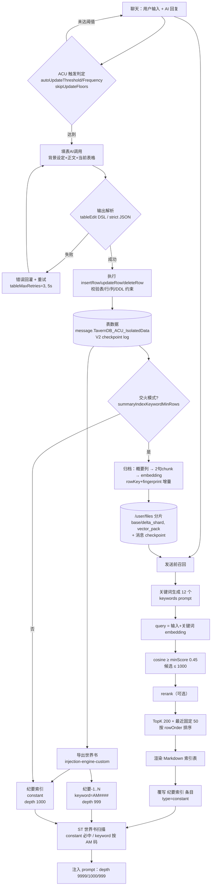

# 酒馆（SillyTavern）"记忆条目"插件原理技术调研

> **调研对象**：本机 `E:\SillyTavern\SillyTavern`（SillyTavern **v1.16.0**）＋ 通过 JS-Slash-Runner 注入的 `https://gcore.jsdelivr.net/gh/AlbusKen/shujuku@spv5.5.6/index.js`（SP·数据库 V / TavernDB-ACU）
> **调研时间**：2026-10-21（Asia/Shanghai）
> **方法**：静态阅读本机源码 + 解析 `data/default-user/settings.json` 的真实配置 + 拉取 jsDelivr 上的 6.38 MB 未混淆产物（100,801 行）与 GitHub 源文件交叉验证
> **证据约定**：`✅` = 已在本机文件/源码中直接读到；`🟡` = 从配置或 UI 文案推断；`🔵` = 推测（未经代码验证）

---

## 0. 一句话结论（TL;DR）

用户口中的"记忆条目插件"**不是 SillyTavern 原生功能，而是第三方脚本 SP·数据库 V（仓库 `AlbusKen/shujuku`，内部名 `acu-star-database-iii`，社区俗称 TavernDB / ACU / "数据库"）**。

它的工程本质可以一句话概括：

> **让 LLM 每轮以"填表指令"（`insertRow`）把剧情压缩成一条结构化纪要行存进 SQLite/JSON 表，再把表行"导出"为世界书条目注入上下文；当行数超过阈值后，改用"概要列 → 向量索引 → 发送前召回 → 覆写世界书索引条目"的两级检索。**

其中"记忆条目"= **纪要表（chronicle）的一行**，字段为 `编码索引(AM0001…) / 时间跨度 / 地点 / 纪要 / 概要`。所谓"向量记忆"= 对**概要列**做 embedding，在**发送前**召回 TopK 行，把结果**覆写进一条常驻世界书条目**。

真正值得学的不是"向量"，而是这三个设计：**① 写入与读取分离（写时结构化、读时压缩）**、**② 稳定主键 + 指纹的增量索引**、**③ 用世界书当"可覆写的注入槽"**。

---

## 1. SillyTavern 原生记忆体系

SillyTavern 本身**没有"记忆条目"概念**，它提供的是 5 条互不统属的"往 prompt 里塞东西"的通道。理解这 5 条通道，才能理解第三方插件为什么必须"寄生"在世界书上。

### 1.1 通道总表（✅ 源码）

| 通道 | 实现文件 | 注入 API | 模块名（决定排序） | 存储位置 |
|---|---|---|---|---|
| Summarize（Memory） | `public/scripts/extensions/memory/index.js` | `setExtensionPrompt('1_memory', …)` | `1_memory` | 聊天消息 `mes.extra.memory` |
| Author's Note | `public/scripts/authors-note.js` | `setExtensionPrompt('2_floating_prompt', …)` | `2_floating_prompt` | `chat_metadata` + `extension_settings.note` |
| Vector Storage（聊天） | `public/scripts/extensions/vectors/index.js` | `setExtensionPrompt('3_vectors', …)` | `3_vectors` | 服务端向量库 collection=`chatId` |
| Vector Storage（Data Bank） | 同上 | `setExtensionPrompt('4_vectors_data_bank', …)` | `4_vectors_data_bank` | 服务端向量库 collection=文件 URL hash |
| World Info / 世界书 | `public/scripts/world-info.js` | 扫描后写入 prompt 各段位 | 由 `position` 决定 | `data/<user>/worlds/*.json` |

模块名的数字前缀是**故意**的排序约定，源码里有注释：

```js
// public/scripts/authors-note.js:26
const MODULE_NAME = '2_floating_prompt'; // <= Deliberate, for sorting lower than memory
```

`public/scripts/openai.js:1285-1314` 按 `1_memory → 2_floating_prompt → 3_vectors → 4_vectors_data_bank → chromadb` 的固定顺序把这些 extension prompt 推入 `systemPrompts`。

注入位置枚举（`public/script.js:455-469`）：

```js
export const extension_prompt_types = { NONE:-1, IN_PROMPT:0, IN_CHAT:1, BEFORE_PROMPT:2 };
export const extension_prompt_roles = { SYSTEM:0, USER:1, ASSISTANT:2 };
export const MAX_INJECTION_DEPTH = 10000;
```

> ⚠️ 注意 `MAX_INJECTION_DEPTH = 10000`：TavernDB 把纪要条目放在 `depth: 999`、索引放在 `depth: 1000`、固定条目放在 `depth: 9999`，正是贴着这个上限在做"层级排序"（越大越靠前/越靠系统侧，取决于 ST 的 depth 语义）。

---

### 1.2 内置 Memory（Summarize）扩展

#### 生成逻辑（✅ `extensions/memory/index.js`）

触发链：`CHARACTER_MESSAGE_RENDERED`（`eventSource.makeLast`，保证最后执行）＋ `MESSAGE_DELETED / MESSAGE_UPDATED / MESSAGE_SWIPED` → `onChatEvent()` → `summarizeChat(context)`。

是否触发由 `getSummaryPromptForNow()` 判定（第 565-626 行）：

1. `promptInterval === 0` → 直接跳过（**自动总结被关闭**）；
2. 若 `selected_group` 正在生成、或 `is_send_press` 未释放 → 等待/放弃；
3. `chat.length < promptInterval` → 跳过；
4. 从尾部往前数，直到遇到带 `extra.memory` 的消息，得到 `messagesSinceLastSummary` / `wordsSinceLastSummary`；
5. `messagesSinceLastSummary >= promptInterval` **或** `promptForceWords > 0 && wordsSinceLastSummary >= promptForceWords` → 触发。

两种 prompt 构建器（`start` 常量 `prompt_builders`，设置项 `prompt_builder`）：

- `DEFAULT (0)`：`generateQuietPrompt({ quietPrompt, skipWIAN, responseLength })` —— 走正常主 prompt 构建，把总结请求作为最后一条 system 消息追加；
- `RAW_BLOCKING (1)` / `RAW_NON_BLOCKING (2)`：自己拼 prompt 后 `generateRaw({ prompt, systemPrompt })`，阻断式还会 `deactivateSendButtons()`。

`getRawSummaryPrompt()`（第 761-825 行）是自己拼 prompt 的核心：从上一次 summary 的下一条消息开始累积，每加一条就 `countSourceTokens(getMemoryString(true), PADDING=64)`，超过 `getSourceContextSize()` 就回退并停止；受 `maxMessagesPerRequest` 限制。**summary 本身会作为"底稿"拼进新 prompt**（"If a summary already exists in your memory, use that as a base and expand with new facts"）。

默认 prompt / 模板（第 105-106 行）：

```js
const defaultPrompt = 'Ignore previous instructions. Summarize the most important facts and events in the story so far. If a summary already exists in your memory, use that as a base and expand with new facts. Limit the summary to {{words}} words or less. Your response should include nothing but the summary.';
const defaultTemplate = '[Summary: {{summary}}]';
```

默认参数（`defaultSettings`，第 108-139 行）：`promptWords=200`、`promptInterval=10`、`depth=2`、`position=IN_PROMPT(0)`、`role=SYSTEM(0)`、`source='extras'`、`scan=false`、`maxMessagesPerRequest=0`。

#### 存哪里（✅）

**不是 chat metadata，而是聊天消息对象上**：

```js
// setMemoryContext()，第 966-987 行
mes.extra.memory = value;      // 默认写到 chat[chat.length - 2]
saveChatDebounced();
```

读取靠 `getLatestMemoryFromChat(chat)`（倒序找第一个 `extra.memory`，且跳过最后一条）。这带来一个副作用：**summary 是"楼层锚定"的** —— 删除/编辑锚点之后的消息会丢 summary（代码第 451-463 行专门处理：消息被编辑则 `delete lastMessage.extra.memory`）。

#### 注入（✅）

```js
setExtensionPrompt(MODULE_NAME /* '1_memory' */, formatMemoryValue(value),
    extension_settings.memory.position, extension_settings.memory.depth,
    extension_settings.memory.scan, extension_settings.memory.role);
```

- `formatMemoryValue()`：有 `template` 就 `substituteParamsExtended(template, { summary })`，否则退化成 `Summary: ${value}`；
- `scan`（设置项"Include in World Info Scanning"）→ 传 false 时该 summary 不参与世界书关键词扫描；
- 位置 4 选 1（`settings.html` 第 119-143 行）：`None(-1)` / `Before Main Prompt(2)` / `After Main Prompt(0)` / `In-chat @ Depth(1)` + role。

#### 与 World Info 的关系（✅）

三层关系：

1. **互斥/包含**：`SkipWIAN` 让总结时**不把**世界书与作者注喂给总结模型（Extras 源永远排除）；
2. **反向参与**：`scan=true` 时 summary 文本会进入世界书关键词扫描缓冲；
3. **宏暴露**：注册 `{{summary}}` 宏（第 1112-1123 行），可在任意 prompt 里引用最新 summary；另有 `/summarize` 斜杠命令（`source/prompt/quiet` + 可选文本参数，第 1086-1110 行）。

#### 本机实际配置（✅ `settings.json`）

```json
"memory": {
  "source": "main",
  "prompt": "Ignore previous instructions. Summarize the most important facts and events in the story so far. ... No word limit, must include all the facts and not delete old ones, even if the summery is long. ... in Chinese.",
  "promptWords": 1000, "promptInterval": 0, "promptForceWords": 0,
  "template": "[Summary: {{summary}}]", "position": 0, "depth": 2, "role": 0,
  "SkipWIAN": false, "scan": false, "prompt_builder": 0
}
```

> 🔎 **关键发现**：`promptInterval=0` 且 `promptForceWords=0` → **本机内置 Memory 的自动总结实际上是关闭的**（只能手动点"Summarize now"或 `/summarize`）。用户感觉到的"记忆"几乎全部来自 TavernDB，而非 ST 原生 Memory。

---

### 1.3 Vector Storage（`extensions/vectors`）

#### 三种对象、三套参数（✅ `index.js:57-115`）

```js
const settings = {
  source: 'transformers',              // 本地 transformers.js；另有 openai/cohere/ollama/vllm/... 
  // 聊天
  enabled_chats: false, template: 'Past events:\n{{text}}', depth: 2,
  position: IN_PROMPT, protect: 5, insert: 3, query: 2,
  message_chunk_size: 400, score_threshold: 0.25,
  // 文件
  enabled_files: false, chunk_size: 5000, chunk_count: 2, overlap_percent: 0, size_threshold: 10,
  // Data Bank
  chunk_size_db: 2500, chunk_count_db: 5, overlap_percent_db: 0,
  file_template_db: 'Related information:\n{{text}}', file_depth_db: 4, file_depth_role_db: SYSTEM,
  // 世界书
  enabled_world_info: false, enabled_for_all: false, max_entries: 5,
  summarize: false, summary_prompt: 'Ignore previous instructions. Summarize the most important parts of the message...'
};
```

#### 检索与注入（✅ `rearrangeChat()` 第 636-719 行）

这是 ST 里最"反直觉"的设计，值得单独说明：

1. 取当前聊天最后 `query=2` 条消息作为 query text；
2. 对 `chatId` collection 做 `queryCollection(chatId, queryText, insert=3)`；
3. 命中的历史消息**从 `chat` 数组里被 `splice` 删除**（第 700-705 行），再拼成一段文本：
   ```js
   const insertedText = getPromptText(queriedMessages); // "name: mes" 拼接后套 template
   setExtensionPrompt('3_vectors', insertedText, settings.position, settings.depth, settings.include_wi);
   ```
4. 最后 `protect=5` 条消息永远保留原位。

**即：向量召回不是"追加"，而是"物理搬移"** —— 被召回的老消息离开原位、聚合成一条 system 提示插到 depth 2。这样既省 token（不重复），又让相关历史贴近对话尾部。

向量化（`synchronizeChat()`）：`protect` 之外的新消息经 `splitByChunks()`（按 `message_chunk_size=400` 递归切分）→ `/api/vector/insert`。检索走 `/api/vector/query`，`topK` + `threshold` 服务端过滤（`src/endpoints/vectors.js`，支持 `src/vectors/*-vectors.js` 多种后端）。

#### Data Bank / 文件 RAG（✅）

- Data Bank 本体是 **attachments 扩展**（`public/scripts/extensions/attachments/index.js`），文件存服务器；
- `ingestDataBankAttachments()` 把附件按 `chunk_size_db=2500` 切块入向量库（collection 按文件 URL hash）；
- 每次生成 `injectDataBankChunks(queryText, collectionIds)` → `queryMultipleCollections(..., chunk_count_db=5, score_threshold=0.25)` → 套 `file_template_db` 注入 depth 4 / system；
- 另有 `/vector-query`、`/vector-ingest` 等斜杠命令（第 2011-2076 行）。

#### 世界书向量化（✅ `activateWorldInfo()` 第 1556-1650 行）

给世界书条目加 `vectorized` 标记 → 条目内容入 `world_<hash>` collection → 生成前用最近上下文做 multi-query，命中前 `max_entries=5` 条被"外部激活"（`buffer.getExternallyActivated(entry)`）。**这是 ST 官方对"关键词触发"的补充，但默认关闭，且只补充激活、不改写内容。**

---

### 1.4 World Info / 世界书

这是 TavernDB 唯一的注入通道，必须吃透。

#### 条目触发（✅）

`world-info.js` 扫描循环（第 4600-4990 行）对每个条目依次判断：标签过滤 → sticky/cooldown/delay → `excludeRecursion`（递归扫描时跳过）→ `@@activate` 装饰器 → `constant` → sticky → 关键词匹配（主键 + 次键 + `selectiveLogic`）。

#### 位置（✅ `world-info.js:857-866`）

```js
export const world_info_position = {
  before: 0, after: 1, ANTop: 2, ANBottom: 3,
  atDepth: 4, EMTop: 5, EMBottom: 6, outlet: 7
};
```

`atDepth` 才有 `depth` + `role`；`ANTop/ANBottom` 会并进作者注。

#### 递归扫描与 `prevent_recursion`（✅ 关键）

```js
// world-info.js:4874
const successfulNewEntriesForRecursion = successfulNewEntries.filter(x => !x.preventRecursion);
// world-info.js:4932-4937
if (scanState) { const text = successfulNewEntriesForRecursion.map(x => x.content).join('\n'); buffer.addRecurse(text); }
```

**语义**：`prevent_recursion=true` 的条目"能被激活，但它的内容不会进入递归缓冲"。而 `exclude_recursion=true` 是另一个字段（"递归时不参与匹配"）。

这个差异决定了 TavernDB 的一条重要链路是否成立（见 §2.7）。

#### 预算（✅）

```js
// world-info.js:4537-4541
let budget = Math.round(world_info_budget * maxContext / 100) || 1;
if (world_info_budget_cap > 0 && budget > world_info_budget_cap) budget = world_info_budget_cap;
```

`world_info_budget` 默认 25（%），`min_activations` 可"继续加深扫描直到凑够 N 条"，`max_recursion_steps` 非 0 时限递归步数（且与 min_activations 互斥）。

本机配置（✅）：

```json
"world_info_settings": { "world_info_depth": 2, "world_info_budget": 100, "world_info_recursive": true,
  "world_info_min_activations": 0, "world_info_budget_cap": 0, "world_info_max_recursion_steps": 0 }
```

> 🔎 `world_info_budget: 100` = **世界书预算占满整个上下文**。这意味着 TavernDB 的全量纪要索引一旦变大，会直接挤掉聊天历史——这是本机最容易踩的坑（见 §4.3）。

#### 与"记忆条目"的区别（一句话）

> 世界书是**「静态设定 + 关键词触发」**；记忆条目是**「动态事实 + 每轮写入」**。世界书回答"这个世界是什么样"，记忆条目回答"我们之间发生过什么"。TavernDB 的做法是把后者**编译成**前者（一行一个关键词条目）。

---

### 1.5 其余上下文管理手段

| 手段 | 文件/命令 | 本质 | 与记忆的关系 |
|---|---|---|---|
| Author's Note | `authors-note.js`，`chat_metadata[note_prompt/note_interval/note_position/note_depth/note_role]` | 每 N 条消息插入一次的"导演提示" | 与 summary 同层，模块名 `2_floating_prompt` 恰好排在 memory 之后 |
| `/summarize` | `extensions/memory/index.js` | 手动/对任意文本做总结 | 产出写回 `extra.memory` |
| Checkpoint / Bookmark | `bookmarks.js`（`/checkpoint-create`、`/checkpoint-go`、`branchChat`） | **分支存档**，不是记忆 | 存的是整条 chat 文件；`extra.bookmark_link` 做楼层↔存档链接 |
| Data Bank | attachments 扩展 | 文件级 RAG 语料 | 与"情节记忆"正交 |
| Itemized Prompts | `itemized-prompts.js` | 输出 token 归因表 | 可用来验证"记忆到底占了多少 token"（很有用的调试工具） |
| 宏 `{{summary}}` | memory 扩展 | 把 summary 暴露给任意 prompt | 比 `setExtensionPrompt` 更灵活的手动注入 |

---

## 2. TavernDB / ACU 深度拆解（重点）

### 2.1 身份卡（✅ 全部实证）

| 项 | 值 | 证据 |
|---|---|---|
| 仓库 | `https://github.com/AlbusKen/shujuku` | GitHub API：`full_name=AlbusKen/shujuku`，`description="龙血玄黄·数据库"`，166 stars / 28 forks，创建 2026-06-29，最后推送 2026-10-19 |
| 分发 | `https://gcore.jsdelivr.net/gh/AlbusKen/shujuku@spv5.5.6/index.js`（6,378,406 B，100,801 行，**未混淆**） | 本机 `settings.json` 里的脚本 URL；HTTP 头 `x-jsd-version: spv5.5.6` |
| 包名/版本 | `acu-star-database-iii` **1.1.0**，description `"SP·数据库 V (AutoCardUpdater) - SillyTavern 数据库自动更新脚本"` | `package.json@spv5.5.6` |
| 油猴头 | `@name SP·数据库 V`、`@version 2.0.0`、`@author Cline (AI Assisted)`、`@description SillyTavern 数据库自动更新与交火模式索引管理脚本。` | 产物第 1-10 行 |
| 唯一 ID | `const UNIQUE_SCRIPT_ID = 'shujuku_v120';` | 产物第 119 行 |
| 运行形态 | 双形态：油猴脚本（跑在 JS-Slash-Runner 的 iframe 里）/ 酒馆插件（跑在主窗口）。`detectRuntimeMode()` 用 `window !== window.parent` 判定 | 产物 `shared/runtime-env.ts` 段 |
| 依赖 | 前端：`sql.js`、`vue`、`pinia`；宿主：JS-Slash-Runner（`TavernHelper`） | `package.json` devDependencies |

**关于"版本号"的三个混淆（用户提到的 spv5.5.6 / v1.20）**：

1. `spv5.5.6` = **jsDelivr 上的 git ref / 构建标签**（`spv` ≈ "SP 数据库 V"）；GitHub 上另有一套 `xingv*`、`test*`、`v15.0` 标签，命名并不统一。🟡
2. `1.1.0` = `package.json` 的构建版本，`2.0.0` = 油猴头手写版本，**两者不同步**（作者维护痕迹）。
3. `shujuku_v120_*` = **存储命名空间 ID**（`UNIQUE_SCRIPT_ID='shujuku_v120'`），**不是版本号**。所以 `shujuku_v120_globalMeta_v1`、`shujuku_v120_profile_v1____default____template` 这些 key 里的 `v1/v120` 是"schema 代次 + 脚本 ID"，不是 1.20 版。

> `ACU` 在代码里几乎每处都作后缀：`AutoCardUpdaterAPI`、`_ACU` 后缀函数名。所以 **ACU = AutoCardUpdater**（自动更新角色卡/表格）。社区说的"ACU 触发"= 自动填表触发。

---

### 2.2 它到底解决什么问题

原生 ST 的三个痛点，正是它的设计目标：

1. **summary 是"一坨散文"**：`extra.memory` 只能整体覆盖，无法定位"第 37 轮那个承诺"；一旦总结漏写就永久丢失。
2. **世界书是静态的**：没法每轮自动追加"刚刚发生的事"。
3. **上下文有限**：500 轮后 summary 必然爆炸，或必须不断重写（信息在重写中衰减）。

它的答案：**把"发生过什么"外置成数据库，让 LLM 每轮增量写入，读取时再按需投影回 prompt**。这是典型的 **write-path / read-path 分离**，而不是"更长的 summary"。

代码里 `src/service/summary/merge-executor.ts`、`merge-logic.ts` 与 `src/service/vector/*` 的存在，说明这套东西已经演化成"轻量级 ETL + 检索服务"，只是宿主是浏览器。

---

### 2.3 数据结构：表（sheet）→ 列 → 行

#### 2.3.1 模板层（✅ 本机真实模板，`settings.json` → `shujuku_v120_profile_v1____default____template`）

用户模板共 8 张表 + `mate` 元数据：

| sheetKey | 名称 | 作用 |
|---|---|---|
| `sheet_dCudvUnH` | 全局数据表 | 地点/时间（`prev_scene_time`、`elapsed_time`、`cur_time`），强制单行 |
| `sheet_DpKcVGqg` | 主角信息表 | 主角状态 |
| `sheet_NcBlYRH5` | 重要角色表 | 人物卡（有 `extraIndexEnabled=true`，导出"重要角色表-索引"） |
| `sheet_lEARaBa8` | 主角技能表 | |
| `sheet_in05z9vz` | 背包物品表 | |
| `sheet_etak47Ve` | 任务与事件表 | |
| **`sheet_3NoMc1wI`** | **纪要表** | **记忆条目本体** |
| `sheet_OptionsNew` | 选项表 | 每轮 4 个行动选项 |

#### 2.3.2 纪要表完整定义（✅ 原样摘录）

```json
{
  "uid": "sheet_3NoMc1wI",
  "name": "纪要表",
  "sourceData": {
    "note": "轮次日志。每轮交互结束后立刻插入一条新记录。\n【列定义】\n- 列1: 编码索引 code_index（AM0001起递增，全表唯一）\n- 列2: 时间跨度 time_span\n- 列3: 概览 summary（≤30字）\n- 列4: 纪要 chronicle_text（240-480字）\n- 列5: 重要对话 key_dialogue（可NULL）",
    "insertNode": "每轮交互结束后插入一条新记录。...\nSQL示例：INSERT INTO chronicle (row_id, code_index, time_span, summary, chronicle_text, key_dialogue) VALUES ((SELECT COALESCE(MAX(row_id), 0) + 1 FROM chronicle), 'AM0036', '2026-02-04 08:00 ~ 2026-02-04 08:30', '一句话概括', '本轮纪要内容...', NULL);",
    "ddl": "CREATE TABLE chronicle ( -- 纪要表\n  row_id INTEGER PRIMARY KEY, -- 行号\n  code_index TEXT NOT NULL UNIQUE CHECK(code_index GLOB 'AM[0-9][0-9][0-9][0-9]'),\n  time_span TEXT NOT NULL CHECK(time_span GLOB '????-??-?? ??:?? ~ ????-??-?? ??:??'),\n  summary TEXT NOT NULL, -- 概览\n  chronicle_text TEXT NOT NULL, -- 纪要\n  key_dialogue TEXT -- 重要对话\n);",
    "updateNode": "禁止。",
    "deleteNode": "禁止。"
  },
  "content": [["row_id","编码索引","时间跨度","概览","纪要","重要对话"]],
  "exportConfig": {
    "enabled": true, "splitByRow": true,
    "entryName": "纪要", "entryType": "keyword", "keywords": "编码索引",
    "preventRecursion": true,
    "injectionTemplate": "<记忆回溯>\n$1\n</记忆回溯>",
    "extraIndexEnabled": true, "extraIndexEntryName": "纪要索引",
    "extraIndexColumns": ["编码索引","时间跨度","概览"],
    "extraIndexColumnModes": {"编码索引":"both","时间跨度":"both","概览":"index_only"},
    "extraIndexInjectionTemplate": "<已发生的事件概览>\n$1\n</已发生的事件概览>",
    "entryPlacement":      {"position":"at_depth_as_system","depth":999, "order":10000},
    "extraIndexPlacement": {"position":"at_depth_as_system","depth":1000,"order":10010},
    "fixedEntryPlacement": {"position":"at_depth_as_system","depth":9999,"order":99987},
    "fixedIndexPlacement": {"position":"at_depth_as_system","depth":9999,"order":99988}
  }
}
```

注意几件事：

- `content` 是**二维数组**（第一行是表头，中文列名），与 `ddl` 的英文列名**并存**——原生模式用数组，SQLite 模式用 DDL；两者靠 `resolveColumnIndexByAliases_ACU(['时间跨度','时间','阶段','时段'], …)` 这种**列名别名**胶合（见 `summary-vector-index-archive-service.ts:316-319`）。
- `updateNode/deleteNode: "禁止。"` —— **纪要是 append-only 的**。这是"记忆不可被覆写"的工程化表达（防污染的核心）。
- `row_id` 由 `COALESCE(MAX(row_id),0)+1` 生成，`code_index` 有 `UNIQUE` + `GLOB 'AM[0-9][0-9][0-9][0-9]'` 双重约束。

#### 2.3.3 一行"记忆条目"的语义样例

| row_id | 编码索引 | 时间跨度 | 概览 | 纪要 | 重要对话 |
|---|---|---|---|---|---|
| 36 | AM0036 | 2026-02-04 08:00 ~ 2026-02-04 08:30 | 主角在御苑与妃咲对峙，得知她隐瞒了契约代价 | （240-480 字第三方视角叙述，无修辞/无对话/开放结尾） | 「妃咲：「你确定要知道？」」 |

> 这一行的设计意图非常明确：**概览用于召回**（≤30 字，可向量化），**纪要用于人读/深挖**（240-480 字），**重要对话用于原句保真**（≤150 token，3-5 句），**编码索引用于二级寻址**（AM0036 当作世界书 key）。

---

### 2.4 行如何产生：填表 AI 的 `insertRow` 指令

#### 2.4.1 触发时机（✅ `evaluateAndQueueTableUpdates` 段，产物 32830-32899 行）

对每张表（`updateConfig` 可覆盖全局）：

```js
const threshold  = (rawDepth === -1 || rawDepth === 0) ? (settings.autoUpdateThreshold || 3) : rawDepth;
const frequency  = (rawFreq === -1) ? globalFrequency : rawFreq;      // autoUpdateFrequency
const skipFloors = Math.max(0, (rawSkip === -1) ? globalSkip : rawSkip); // skipUpdateFloors
const effectiveUnrecordedFloors = Math.max(0, (totalAiMessages - skipFloors) - lastUpdatedAiFloor);
if (frequency > 0 && effectiveUnrecordedFloors >= frequency && threshold > 0) { … }
const contextScopeIndices = effectiveAiIndices.slice(-threshold);   // 只看最近 threshold 楼
const indicesToUpdate = unupdatedAiIndices.filter(idx => contextScopeSet.has(idx));
```

即：**"最近 N 楼窗口内、尚未入表的 AI 楼层"才会被填**。本机默认（✅）：

| 参数 | 值 | 含义 |
|---|---|---|
| `autoUpdateEnabled` | true | 开 |
| `autoUpdateThreshold` | 3 | 上下文窗口 = 最近 3 个 AI 楼层 |
| `autoUpdateFrequency` | 1 | 每 1 个未记录楼层就可能触发 |
| `autoUpdateTokenThreshold` | 500 | **AI 回复字符数下限**（`aiResponse.length < 500` 视为失败重试，见 34946-34949 行）——注意键名说 token，实际比的是 `length` 字符数 🟡 |
| `updateBatchSize` | 3 | 每批最多 3 个楼层 |
| `skipUpdateFloors` | 1 | 跳过最新 1 层（避免填到一半的回复） |
| `maxConcurrentGroups` | 1 | 并发组数 |
| `tableMaxRetries` | 3 | 失败重试次数 |

触发事件是 `GENERATION_ENDED` 系（`shouldProcessAutoTableUpdateForGenerationEnded_ACU`），并有 `generationGate_ACU` 做"是否真人发送意图"的门控（`hasFreshUserGenerationTrigger_ACU`，过滤 `automatic_trigger` 与 quiet 生成）。

#### 2.4.2 填表 prompt（✅ `DEFAULT_CHAR_CARD_PROMPT_ACU`，产物 1201-1246 行）

三段式：`背景设定($U/$C/$4)` → `正文数据($1)` → `当前表格数据($0)`，主段（`mainSlot:"A"`）是**协议说明**，关键片段：

```
你是【填表AI】，负责根据用户提供的资料对表格数据执行增删改操作。
## 输出格式（严格执行）
<thought>
[分析当前轮次的剧情变化]…[逐步推理每个修改操作，说明理由]
针对纪要表的额外规则：如果<当前表格数据>里存在纪要表，那么本轮就必须对其进行插入一条新的总结记录。
</thought>
<content>
<tableEdit>
insertRow(表格ID, {"0":"字段0值","1":"字段1值"})
updateRow(表格ID, 行号, {"0":"字段0值"})
deleteRow(表格ID, 行号)
</tableEdit>
</content>
## 格式要点
- 必须使用双引号 / 逗号后不加空格 / 表格ID、行号必须输出纯数字
- 对象里的每一列都必须显式写成 "数字键":"值"
- 字段值内部双引号必须转义为 \"，换行必须写成 \n
```

> 这是**"用 prompt 当编译器"**：把结构化写入降维成"模型输出可解析的 DSL"，再用状态机解析。代价见 §2.10。

#### 2.4.3 SQLite 模式（✅）

`storageMode` 默认 `'native'`（JSON 二维数组），可切 `'sqlite'`（`sql.js` WASM）。切到 SQLite 后：

- `DEFAULT_CHAR_CARD_PROMPT_SQL_ACU` 把 DSL 换成 `INSERT INTO …`；
- 执行后带 **assert**：`assertSqlMutationChanged_ACU('insertRow', …)`，若 `mutationResult` 影响 0 行则判定失败并回灌错误（见 56134-56154 行）。

本机是 `storageMode: "native"`（✅ `profile…settings`）。

---

### 2.5 合并 / 精简（Merge）

这是"记忆条目"能长期存活的另一半：**表不能无限增长**。

#### 配置（✅）

```json
"mergeSummaryPrompt": "---BEGIN PROMPT---\n[System]\n你是\"填表美杜莎\"…",
"mergeTargetCount": 1,
"mergeBatchSize": 5,
"mergeStartIndex": 1,
"autoMergeEnabled": false,
"autoMergeThreshold": 20,
"autoMergeReserve": 0
```

#### `mergeSummaryPrompt` 的骨架（✅ 设置里存了 3,905 字符）

它是"填表美杜莎"提示词，核心机制是 **CoAT 线性化推理 + 自评分门槛 + 硬约束审计**：

```
[Input] TASK / TARGET_COUNT: $TARGET_COUNT / $A（本批纪要）/ $BASE_DATA（已精简底稿）

[Constraints — 硬约束，违反任意一条即判定输出无效]
C1-编码索引严格递增  C2-纪要 ≥300 且 ≤400 中文字  C3-概要 ≤30 字
C4-条目总数 = $TARGET_COUNT  C5-编码从 AM0001 连续不跳号
C6-关键节点/人物行为/因果不得丢失  C7-时序正确
C8-仅使用 insertRow，colIndex 必须是双引号字符串

[Scoring] Fg = 0.30*g1 + 0.25*g2 + 0.20*g3 + 0.15*g4 + 0.10*g5，Fg ≥ 0.80 方可输出

[Search Controller] Round N: Analyze → Draft(2~3 策略) → Select → Expand → Audit → Score
── 终止条件 ──  全部约束通过 + Fg ≥ 0.80 → 输出 <tableEdit>
                 修正轮次超限 → 输出当前最优结果并在 thought 中标注"预算终止"
```

> 🔎 **一处真实的配置漂移（重要）**：该 prompt 里写的列定义是
> `列1 时间跨度 / 列2 地点 / 列3 纪要 / 列4 概要 / 列5 编码索引`（5 列、含"地点"），
> 而本机实际 `纪要表` 是 `row_id / 编码索引 / 时间跨度 / 概览 / 纪要 / 重要对话`（6 列、无"地点"、有"重要对话"）。
> **精简时模型会按错的列序生成 `{"0":…}` 映射**，直接把"时间跨度"写进"编码索引"列。这是"prompt 与 schema 各自演化"的典型事故，也是 Herein 必须避免的（见 §4.5）。

#### 语义解读

- `mergeTargetCount: 1` 表示"这一批合并成 1 条"（把 5 条压成 1 条）；`mergeBatchSize: 5` 是每次取 5 条参与合并；`mergeStartIndex: 1` 从第 1 条开始。
- `autoMergeEnabled: false` + `autoMergeThreshold: 20`：行数超 20 才自动合并（本机**关闭**）。
- 合并会**重编号**（AM0001 起连续），因此 `编码索引` 不是稳定 ID —— 这与向量索引的 `rowKey = buildStableSummaryRowKey(summaryKey, rowId, indexCode)` **存在冲突风险**：合并后 code_index 变了，rowKey 就变，索引会整段重建。🟡（代码对 `sourceFingerprint` 做了逐行比对，但对"重编号"这种全表变动只能全量重建。）

---

### 2.6 存储位置：到底存在哪？

这是最容易搞错的部分。**四层存储，各司其职**（✅ 源码）：

| 数据 | 位置 | 证据 |
|---|---|---|
| **纪要表 / 所有表数据** | **聊天消息对象上**：`message.TavernDB_ACU_IsolatedData[isolationKey]` → `tagData.storageFrame`（V2 checkpoint + log） | `parseIsolatedDataField()` 读 `msg.TavernDB_ACU_IsolatedData`；`readIsolatedTagData_ACU(msg, isolationKey)` |
| 旧版字段（兼容） | `message.TavernDB_ACU_Data` / `…_IndependentData` / `…_SummaryData` / `…_Identity` / `…_ModifiedKeys` | `readLegacy*_ACU()` |
| **脚本设置** | `extension_settings.__userscripts['shujuku_v120__userscript_settings_v1']`（即 `settings.json`）＋ IndexedDB `shujuku_v120_config_v1/kv` ＋ localStorage 兜底 | `TAVERN_SETTINGS_NAMESPACE_ACU = \`${SCRIPT_ID_PREFIX_ACU}__userscript_settings_v1\`` |
| **向量索引** | `/user/files` 外置分片（`base_shard/delta_shard/vector_pack/manifest/row_index/tombstone/registry`）＋ 消息里的轻量 `checkpoint` 指针 ＋ IndexedDB 热缓存 | `buildVectorIndexStableFilePath_ACU()`；`SummaryVectorIndexExternalFileRole_ACU` |
| 临时/导入暂存 | IndexedDB `…_import_temp` + 内存 Map | `importTempSet_ACU()` |

#### `settings.json` 里的 `shujuku_v120_*`（✅ 实际内容）

```jsonc
"extension_settings": {
  "tavern_helper": { … },                       // JS-Slash-Runner 自己的设置
  "__userscripts": {
    "shujuku_v120__userscript_settings_v1": {
      "shujuku_v120_globalMeta_v1": "{\"version\":1,…\"vectorMemoryConfigGlobal\":{…}}",   // 双层 JSON 字符串
      "shujuku_v120_profile_v1____default____template": "\"{\\n  \\\"sheet_dCudvUnH\\\"…}\"", // 双层 + 转义
      "shujuku_v120_profile_v1____default____settings": "{…}",                            // 152 KB
      "shujuku_v120_windowStates": "{…}",
      "shujuku_v120_ui_theme_v1": "silk"
    }
  }
}
```

> 🟡 **工程债**：设置值是"JSON 字符串套 JSON 字符串"（`globalMeta` 与 `template` 都是双层编码）。解析要 `ConvertFrom-Json` 两次，任何一层的引号/换行处理失误都会静默降级为默认值。这是本机 `template` 里出现 `\"…\"` 的原因。

#### 向量索引文件名规则（✅）

```js
// buildVectorIndexFileName_ACU
`TavernDB_ACU_vector_${chatKey}_${isolationKey}_${indexId}_${role}${shardId}`
// buildVectorIndexStableDirectory_ACU
['TavernDB_ACU_vector', chatKey, isolationKey||'default', sourceTableKey||'summary'].join('_')
// registry 固定路径
SUMMARY_VECTOR_INDEX_REGISTRY_PATH_ACU = 'TavernDB_ACU_vector_registry'
```

#### `ChatSummaryVectorIndexState` 数据模型（✅ `summary-vector-index-types.ts`）

```ts
interface ChatSummaryVectorIndexRow_ACU {
  rowKey: string; rowId: string; rowOrder: number;
  timeSpan: string; location: string; summary: string; indexCode: string;
  vectorSourceText: string;        // ← 实际等于 summary（只索引概要列！）
  chunkIds: string[]; sourceFingerprint?: string;
  status?: 'active' | 'removed' | 'replaced';
}
interface ChatSummaryVectorIndexChunk_ACU {
  chunkId: string;   // `${rowKey}:chunk:${i}`
  rowKey: string; rowOrder: number; text: string; vector: number[]; sequence: number;
}
interface ChatSummaryVectorIndexManifest_ACU {
  backend: 'st-files'; status: 'building'|'uploading'|'ready'|'missing'|'corrupt'|…;
  indexId; chatKey; isolationKey; snapshotMessageId; sourceTableKey;
  embeddingModel; dimension; rowCount; chunkCount;
  files: ExternalFileRef[]; snapshot?: {revision, activeRowKeys[], removedRowKeys[]};
  checkpoint?: {manifestKey, snapshotMessageId, activeRowKeys[]};
  contentAddressed?: {mode:'content_addressed_chunks'|'content_addressed_packs', chunkRefs[], activeChunkKeys[]};
}
```

**存储设计的三个要点**：

1. **索引状态挂在"楼层"上**（`messageIndex` + `snapshotMessageId`），所以**回滚/分支聊天会自然带出对应版本的索引**（`getAggregatedSummaryVectorIndexSnapshot` 按层聚合）；
2. **向量本身不写在聊天记录里**（注释明说："新外置模式下聊天记录不应再写入该字段"），只留 `checkpoint` 轻指针 + `/user/files` 分片 + IndexedDB 热缓存；
3. **content-addressed + tombstone**：chunk 按内容 hash 去重（`content_addressed_chunks|packs`），删除走墓碑（`row_deleted/row_replaced/index_deleted/compact`），配 `reachability` GC 防误删。

---

### 2.7 注入逻辑：为什么"世界书"是唯一通道

**关键发现：整个插件没有调用 `setExtensionPrompt`（✅ 全库 0 命中）。所有上下文注入 100% 通过世界书条目完成。**

`src/service/worldbook/injection-engine-custom.ts`（45 KB）+ 产物 25260-25868 行是这条流水线。

#### 2.7.1 每行 → 一个关键词条目（`splitByRow: true`）

```js
// 产物 25648-25677（节选）
mainRows.forEach((rowData, i) => {
  const entryName = `${config.entryName}-${i + 1}`;      // 纪要-1、纪要-2 …
  let keys = [];
  if (config.keywords) {                                  // "编码索引"
    splitKeywordsByComma_ACU(config.keywords).forEach(k => {
      const colIndex = headers.indexOf(k);
      if (colIndex !== -1) keys.push(...splitKeywordsByComma_ACU(rawRowData[colIndex])); // → AM0036
      else keys.push(k);
    });
  }
  if (config.entryType === 'keyword' && keys.length === 0) return;
  const finalContent = buildEntryContent(entryName, rowTableMarkdown, config.injectionTemplate, …);
  rowEntries.push(applyPlacementToEntry_ACU({
    comment: fullComment, content: finalContent, keys, enabled: true,
    type: config.entryType || 'constant',
    prevent_recursion: config.preventRecursion !== false,   // → true
    order: dataOrder
  }, entryPlacement));
});
```

生成的世界书条目形如（🔵 依代码结构还原）：

```jsonc
{
  "comment": "TavernDB-ACU-CustomExport-纪要-36",
  "key": ["AM0036"],
  "keysecondary": [],
  "content": "<记忆回溯>\n| AM0036 | 2026-02-04 08:00 ~ 08:30 | 主角在御苑与妃咲对峙… | 「妃咲：你确定要知道？」 |\n</记忆回溯>",
  "constant": false,
  "selective": true,
  "order": 10036,
  "position": 4,                 // atDepth
  "depth": 999,
  "role": 0,
  "excludeRecursion": false,
  "preventRecursion": true,
  "extensions": { "position": 4, "depth": 999, "role": 0, "prevent_recursion": true }
}
```

> ⚠️ **这条链默认是断的**：明细条目的 key 是 `AM0036`，而能提供 `AM0036` 的"纪要索引"条目自身 `prevent_recursion: true` → 它的内容**不会进入递归缓冲**（`world-info.js:4874`）→ **明细条目几乎永远不会被索引自动触发**。
>
> 结论：**实际进入上下文的是"索引表"（编码+时间+概览），不是 240-480 字的纪要正文**。正文只在两种情况下出现：① 用户在聊天里真的提到了 `AM0036`；② 手动/外部 API 激活该条目。这一点与很多用户的直觉相反，也是"记忆条目很轻"的原因。

#### 2.7.2 索引条目 → 一条常驻 `constant` 条目

```js
// buildExtraIndexEntryBlock_ACU，产物 25466-25503
const fullTable = buildMarkdownTableFromRows_ACU(extraIndexSpec.indexCols, extraIndexSpec.indexRows);
let mainContent = buildEntryContent(extraIndexSpec.entryName, fullTable, templateStr, false, fallbackTemplate);
if (!isImport && isCrossfireSummaryEntry && summaryVectorIndexModeEnabled && crossfireThresholdMet) {
  const existingEntry = allEntries.find(e => e.comment === mainComment);
  if (existingEntry?.content) {
    mainContent = existingEntry.content;   // ← 保留发送前召回的覆写结果，不被普通填表冲掉
  }
}
entries.push(applyPlacementToEntry_ACU({
  comment: mainComment, content: mainContent, keys: [], enabled: finalEnabled,
  type: 'constant', prevent_recursion: true, order: cursor
}, normalizedPlacement));
```

- 条目名：`TavernDB-ACU-CustomExport-纪要索引`（有隔离码时前缀 `ACU-[code]-`）；
- `type: 'constant'` → 每轮必进 prompt；
- `keys: []`；
- `depth: 1000 / order: 10010` → 紧贴对话尾部（对应 `extraIndexPlacement`）；
- `enabled` 由 **0TK 占用模式**单独控制（`extraIndexEntryEnabled = !zeroTkOccupyMode`）。

#### 2.7.3 两种模式的差别（✅ 产物 25271-25296）

```js
const zeroTkOccupyMode = worldbookConfig?.zeroTkOccupyMode === true;   // 0 token 占用：把条目 enabled=false
const summaryVectorIndexModeEnabled = worldbookConfig?.summaryVectorIndexModeEnabled === true;
const extraIndexEntryEnabled = !zeroTkOccupyMode;
…
crossfireThresholdMet = indexedRowCount >= config.summaryIndexKeywordMinRows;
```

| 模式 | 纪要索引内容 | 谁写 |
|---|---|---|
| 普通模式（本机当前） | **全量** Markdown 索引表（所有行） | 每次填表后由 `injection-engine-custom` 重建 |
| 交火/向量模式（≥200 行） | **召回子集**（最近 50 + TopK） | 发送前由 `processSummaryVectorIndexBeforeGeneration_ACU` 覆写；普通填表**跳过覆盖**以保护召回结果 |
| 0TK 占用模式 | 条目存在但 `enabled=false` | 只占世界书槽位，不占 token |

> 这是一个很聪明的"**双向所有权约定**"：普通导出负责"保底全量"，向量召回负责"覆写子集"，靠"条目已存在且有内容就不覆盖"来避免两者互相踩。

#### 2.7.4 注入的"位置设计"（✅ 默认模板）

```
depth 999   ← 每条纪要明细（keyword, AM####）       order 10000+
depth 1000  ← 纪要索引（constant, 全量/召回）        order 10010
depth 9999  ← fixedEntry/fixedIndex（总结表/大纲等） order 99987/99988
```

ST 的 depth 语义是"距对话末尾的楼层数"，**数值越大越靠前**。所以顺序是：`固定条目(9999) → 索引(1000) → 明细(999) → 真实对话`。即"**越稳定的越靠前，越贴近当下的越靠后**"。

---

### 2.8 向量记忆（"交火模式"）全流程

#### 2.8.1 配置：哪些真的生效（✅ 逐项核对）

本机 `globalMeta.vectorMemoryConfigGlobal` 实际值：

```jsonc
{
  "enabled": false,                       // 向量记忆总开关（关）
  "threshold": 50,                        // 🔵 遗留字段：只在 normalize/validate 出现，无消费点
  "archiveTriggerCount": 9,               // 🔵 遗留：同上（UI 里是 hidden input）
  "archiveBatchSize": 3,                  // 🔵 遗留：同上
  "archiveMaxConcurrency": 3,             // 🔵 遗留
  "summaryIndexArchiveMaxConcurrency": 30,// ✅ 生效：UI 标签"每批归档行数"，产物 34169 行 maxRowsPerBatch
  "topK": 200,                            // ✅ 最终覆盖条数上限
  "minScore": 0.45,                       // ✅ embedding 预筛阈值
  "embeddingEndpoint": "", "embeddingApiKey": "", "embeddingModel": "",   // ✅ 必填，否则整条链跳过
  "rerankEndpoint": "", "rerankApiKey": "", "rerankModel": "",            // ✅ 可选
  "rerankInstruction": "请根据当前用户输入及关键词，判断每个候选纪要条目的相关性…",
  "vectorNamespace": "chat",
  "entryComment": "TavernDB-ACU-VectorMemory",       // 🔵 遗留：旧版"把记忆写成一个条目"的命名
  "entryKey": "TavernDB-ACU-VectorMemory-Key",       // 🔵 遗留
  "summaryIndexKeywordMinRows": 200,      // ✅ 触发门槛：索引行数 ≥200 才启用召回
  "summaryChunkSentenceCount": 2,         // ✅ 概要列按 2 句切 chunk
  "summaryPromptGroupId": "remote-memory-archive-default", // 🔵 遗留（占位符 $SUMMARY_SOURCE_ROWS 无消费点）
  "archiveWithoutSummary": false,         // 🔵 遗留（hidden）
  "recentFixedInjectCount": 50,           // ✅ 最近 50 条固定注入，不参与排序
  "keywordApiPreset": "", "keywordContextPairCount": 1, "keywordGenerationMaxAttempts": 3,  // ✅
  "recallCandidateLimit": 1000            // ✅ 预筛候选上限（也是 rerank 最大输入）
}
```

> 🔎 **重大发现：一半的"向量记忆参数"是遗留字段。**
> `threshold`、`archiveTriggerCount`、`archiveBatchSize`、`archiveMaxConcurrency`、`entryComment`、`entryKey`、`summaryPromptGroupId`、`archiveWithoutSummary` 在 spv5.5.6 里**只有 配置归一化 / 校验 / UI 渲染**，没有任何检索或生成逻辑读取它们。
> 尤其 `summaryPromptGroup`（"远记忆大总结"提示词）—— 占位符 `$SUMMARY_SOURCE_ROWS` 全库只出现在默认值里，**没有任何代码填充它**。
> 也就是说：**"近期纪要 → 远记忆大总结 → 向量索引"这条链路在当前版本并未实现**；实际做的是**逐行概要直接向量化**。这解释了为什么用户设置里有 `summaryPromptGroup` 却感觉"没生成过大总结"。

#### 2.8.2 归档（写路径）

```
填表保存 → finalizeTableEditAfterCommit → 防抖归档入队（enqueueSummaryVectorIndexFlush）
        → archiveSummaryVectorIndexNow({ vectorizeOnly }) 
        → buildPreparedRows → 逐行 fingerprint 比对 → 只对新增/变更行做 embedding
        → chunkTextBySentenceCount(概要, 2) → createEmbeddings(batch ≤ 30 行)
        → persistSummaryVectorIndexSnapshot → /user/files 分片 + 消息 checkpoint
```

核心代码（✅ `summary-vector-index-archive-service.ts:309-357`）：

```ts
const timeSpanColIdx = resolveColumnIndexByAliases_ACU(headerRow, ['时间跨度','时间','阶段','时段'], 0);
const locationColIdx = resolveColumnIndexByAliases_ACU(headerRow, ['地点','位置','场景','场所'], 1);
const summaryColIdx  = resolveColumnIndexByAliases_ACU(headerRow, ['概要','概览','概述','摘要']);
const indexColIdx    = resolveColumnIndexByAliases_ACU(headerRow, ['编码索引']);
if (summaryColIdx < 0) return { error: '纪要表缺少概要列，无法构建纪要向量索引。' };
if (indexColIdx  < 0) return { error: '纪要表缺少编码索引列，无法构建纪要向量索引。' };
const vectorSourceText = summary;                      // ★ 只索引概要，不索引正文
preparedRow.rowKey = buildStableSummaryRowKey_ACU(summaryKey, rowId, indexCode);
preparedRow.sourceFingerprint = buildPreparedRowFingerprint_ACU(preparedRow);
```

分块（✅ 288-307 行）：

```ts
function splitSentences_ACU(text) { return text.match(/[^。！？!?；;\n]+[。！？!?；;]?/g); }
function chunkTextBySentenceCount_ACU(text, sentenceCount) { /* 每 N 句一个 chunk */ }
```

chunkId = `` `${rowKey}:chunk:${chunkIndex}` ``，行→chunk 双向引用（`row.chunkIds`、`chunk.rowKey`）。

#### 2.8.3 召回（读路径，✅ `processSummaryVectorIndexBeforeGeneration_ACU` 54537-54672）

```
① 门控：summaryVectorIndexModeGlobal === true；userInput 非空；
        8 秒内同签名去重（SUMMARY_VECTOR_INDEX_RUNTIME_DEDUPE_MS_ACU = 8000）；
        配置校验（embeddingEndpoint/Model 必填，recallCandidateLimit ≥ topK）
② 取索引：getLatestSummaryVectorIndexSnapshotState() → rows（过滤 status!=='removed' 且 activeRowKeys）
③ 门槛：rows.length < summaryIndexKeywordMinRows(200) → skip 'below_min_rows'   ★ 200 行以下完全不召回
④ 载入 chunks（外置 manifest → 缺文件/校验失败则清缓存并跳过，reason 分明）
⑤ 固定注入：按 rowOrder 降序取最近 recentFixedInjectCount(50) 行 → recentFixedRows
⑥ 候选池：olderRows = rows - recentFixedRows
⑦ 关键词：generateKeywords_ACU() → LLM 输出 <keywords>，解析 12 个（最多 24）
⑧ 查询向量：queryText = `${userInput}\n关键词：${keywords.join('，')}` → createEmbeddings
⑨ 预筛：仅对 olderRows 的 chunks 做 cosine；score < minScore(0.45) 丢弃；
        sort desc → slice(0, recallCandidateLimit=1000)
⑩ 重排：rerankCandidates_ACU()（POST {model, query, documents[], instruction} → results[].relevance_score）
        失败则回退 embedding 顺序
⑪ 取行：按 rerank 顺序去重取行，直到 topK(200)
⑫ 合并：recentFixedRows（score=1.0）∪ selected → 去重 → 按 rowOrder 升序
⑬ 渲染：buildSummaryIndexOverwriteContent_ACU() → Markdown
⑭ 落盘：upsertOriginalSummaryIndexEntry_ACU() → 覆写世界书 `TavernDB-ACU-CustomExport-纪要索引`
```

渲染格式（✅ 54490-54508）：

```js
const lines = ['# 纪要索引', '', '| 时间 | 地点 | 概要 | 编码索引 |', '|---|---|---|---|'];
selectedRows.forEach(row => lines.push(`| ${row.timeSpan} | ${row.location} | ${row.summary} | ${row.indexCode} |`));
```

写入世界书（✅ 54509-54536）：

```js
const comment = `${getIsolationPrefix_ACU()}TavernDB-ACU-CustomExport-纪要索引`;
const nextEntry = { …existing, comment, content, keys: [], enabled, type: 'constant',
                    order: 10000, prevent_recursion: true };
```

#### 2.8.4 关键词生成 prompt（✅ 完整原文）

```
[system]
你负责为交火模式纪要索引召回生成检索关键词。
你会看到最近对话上下文和当前用户输入。
目标：输出最相关的 12 个简洁关键词或短语，用于纪要索引召回与重排序。
优先级：人物、地点、时间、事件、目标、冲突、道具、组织、关系变化、未解决问题。

【输出格式 — 必须严格遵守】
你的回复必须且只能包含以下两部分，不得使用其他任何格式：

<thinking>
逐步分析最近上下文、当前用户输入、涉及人物、地点、时间、事件、目标、冲突、道具、组织、关系变化和未解决问题。
</thinking>
<keywords>关键词1，关键词2，关键词3</keywords>

【硬性规则】
- 关键词必须且只能放在 <keywords></keywords> 标签之间。
- 禁止使用"关键词："前缀输出，禁止使用编号或列表格式。
- <keywords> 标签内只放关键词或短语，不要放解释句、编号、前后缀说明。
- 多个关键词必须使用中文逗号分隔。
- 尽量输出 12 个，最多 24 个。
- <keywords> 标签外的任何内容都不会被用于检索匹配。

[user]
最近上下文：
$RECENT_CONTEXT

当前用户输入：
$USER_INPUT

请根据以上内容生成交火模式纪要索引召回关键词。先在 <thinking> 中分析，然后在 <keywords></keywords> 标签中输出关键词。

[assistant]
<thinking>          ← 预填，强制模型从 thinking 续写
```

解析兜底（✅ `parseKeywords_ACU`）：先 `<keywords>` 正则提取；失败则 `stripThinkingBlocks` 后按 `关键词[：:]` 前缀回退；再按 `[，,、\n;；|]` 切分、去重、去序号、截断 24 个。**这是很好的"格式契约 + 降级解析"范式。**

---

### 2.9 多表协作与 ACU 触发

#### 表间分工（✅ 模板语义）

```
全局数据表(单行) ── 提供 cur_time / current_location ──┐
主角信息表 / 技能表 / 背包表 / 任务表 ── 提供"状态" ───┤→ 一起注入（constant，depth 9999）
重要角色表 ── 提供"人"（有 extraIndex，走索引）────────┤
纪要表 ── 提供"事"（AM 编码，走索引 + 向量）──────────┘
选项表 ── 提供"下一步动作"（默认 exportConfig.enabled=false）
```

派生表（由 `plotSettings`/剧情推进生成）：`总结表`、`总体大纲`、`重要人物表` —— 它们用 `fixedEntryPlacement/fixedIndexPlacement`（depth 9999），因为"**长期不变，应放在最靠系统侧**"。

#### 触发时机汇总

| 时机 | 钩子 | 行为 |
|---|---|---|
| AI 回复生成结束 | `GENERATION_ENDED` / `MESSAGE_RECEIVED` | 判定是否 ACU → 分批填表 |
| 用户点"手动更新" | UI / `AutoCardUpdaterAPI` | 忽略 threshold，强制填最近 N 楼 |
| 填表提交后 | `finalizeTableEditAfterCommit` | 重建世界书导出 + 入队向量归档 |
| 发送前 | `GENERATION_AFTER_COMMANDS` / `TavernHelper.generate` | 交火召回 → 覆写索引条目 |
| 切聊天 | `CHAT_CHANGED` | `clearRuntimeForNoActiveChat` / 载入楼层索引快照 |
| 导入/迁移 | `importSplitSize=10000`、legacy migration | V1→V2 checkpoint 迁移 |

#### 0TK 占用模式与数据隔离

- **0TK**：把生成条目的 `enabled` 置 false，"占位不占 token"，用于手动控制注入时机；
- **数据隔离**（`dataIsolationEnabled` + `dataIsolationCode`）：所有条目加前缀 `ACU-[code]-`，标签数据按 `isolationKey` 分桶，实现"一份世界书跑多个存档"。

---

### 2.10 失败处理与校验（这块做得比多数插件扎实）

#### ① DSL 解析：手写状态机（✅ `extractTableEditDslCommands_ACU` 8726-8783）

不是正则一把梭，而是**括号深度 + 字符串状态机**：

```js
for (let i = openParenIndex; i < cleaned.length; i++) {
  const char = cleaned[i];
  if (inString) { if (escaped) escaped=false; else if (char==='\\') escaped=true; else if (char===stringChar) inString=false; continue; }
  if (char === '"' || char === "'") { inString = true; stringChar = char; continue; }
  if (char === '(') depth++;
  else if (char === ')') { depth--; if (depth === 0) { commandEnd = i+1; break; } }
}
```

先 `replace(/<!--|-->/g,'')` 去注释，再逐条切命令，最后 `parseDslArgs_ACU` 用"第一个 `{` 之前当位置参数、之后当 JSON"的混合解析（容忍 `insertRow(0, {…})` 与 `insertRow("纪要表", {…})`）。

#### ② 语义校验（✅ `applyTableEditCommands` 11074-11230）

- 表索引不存在 / 表无 `content` → `logWarn` 并 skip；
- `deleteRow` 越界 / `updateRow` 行不存在 → skip；
- 行锁（`tableUpdateLocks`）阻止 `updateRow`；
- 标准表 vs 总结表"更新模式"互斥（`[屏蔽] 总结表更新模式(手动)：忽略标准表的insertRow操作`）；
- 合并指令（多表同批）用 `updateGroups` 去重。

#### ③ 重试与反馈注入（✅ `callAiForTableFill` 34916-34984）

```js
let lastErrorMessage = 'AI响应中未找到完整有效的 <tableEdit> 标签';
for (let attempt = 1; attempt <= maxRetries; attempt++) {
  if (feedback?.lastSqlError) dynamicContent.tableDataText += `[SQL执行错误，请修正后重新输出]\n错误信息: ${feedback.lastSqlError}`;
  try {
    const aiResponse = await callCustomOpenAI_ACU(…);
    if (aiResponse.length < settings.autoUpdateTokenThreshold) throw new Error(`AI回复过短 (${len} 字符)，低于阈值`);
    if (!aiResponse.includes('<tableEdit>') || !aiResponse.includes('</tableEdit>')) throw new Error('AI响应中未找到完整有效的 <tableEdit> 标签');
    return { success: true, attempt, aiResponse, tableEditText };
  } catch (e) {
    if (attempt < maxRetries) { await sleep(5000); }   // ← 固定 5s 退避
  }
}
return { success: false, attempt: maxRetries, error: `填表在 ${maxRetries} 次尝试后仍失败: ${lastErrorMessage}` };
```

**失败 → 把错误文本塞回下一轮 prompt** → 让模型自我修正。这是"LLM 写结构化数据"的标准做法，但**没有指数退避、没有 JSON repair、没有 schema 级报错定位**（只给整段错误字符串）。

#### ④ 严格 JSON 模式

`strictJsonTableFillEnabled`（本机 false）+ `strictJsonSqlCharCardPrompt`：要求模型输出严格 JSON（而非 DSL），由 `extractStrictJsonTableFillResponse_ACU` 校验，失败带 `retryHint`。

#### ⑤ 索引侧容错（✅ 召回函数里分级）

```js
catch (error) {
  if (isMissingExternalVectorFileError_ACU(message))  { 清缓存 + 保留指针 → skip 'external_vector_files_missing' }
  if (isInvalidExternalVectorFileError_ACU(message))  { 清缓存 + 保留指针 → skip 'vector_index_corrupted_rebuild_required' }
  throw error;
}
```

配合 `inspectSummaryVectorIndexHealth_ACU()` 输出 `missing_file / checksum_mismatch / identity_mismatch / legacy_manifest / unreachable_registered_file / pack_chunk_missing` 六类健康问题 —— 这是**生产级索引该有的自检**。

---

## 3. 同类"记忆条目"方案横向对比

### 3.1 中文社区常见路线（按机制分类）

> 说明：除 **TavernDB/ACU** 与 **ST 原生**外，社区同类插件版本迭代极快、命名混乱，下表按**机制**归类；具体插件实现细节本文未逐一验证，标 🟡/🔵。

| 路线 | 代表 | 写入方式 | 存储 | 读取方式 | 优点 | 缺点 |
|---|---|---|---|---|---|---|
| **A. 定时摘要** | ST 内置 Summarize、各类"自动总结"脚本 | LLM 重写一段散文 | `mes.extra.memory` / 变量 / 世界书 | 每轮整段注入 | 实现最简单、零检索成本 | 信息有损且不可定位；越写越糊；无法回答"第 37 轮那个承诺" |
| **B. 结构化表格** | **TavernDB / ACU / 数据库 5.x~6.x**（本机验证）、各类"状态栏/面板"脚本 | LLM 输出 `insertRow/updateRow` DSL 或 SQL | 聊天消息 tag data / SQLite(WASM) / 变量 | 世界书导出（全量或索引） | 可定位、可审计、可合并；状态一致性强 | prompt 工程重；解析/校验/重试成本高；表会膨胀；schema 漂移风险 |
| **C. 向量记忆** | ST Vector Storage（原生）、中文"向量记忆/记忆增强"脚本 | 消息或条目切块 embedding | 服务端向量库 / 外置分片 | 相似度 TopK 注入 | 语义召回强、可跨很远 | 无时间/因果结构；近因偏差；chunk 割裂；需 embedding 服务 |
| **D. 世界书自动整理** | "世界书自动生成/整理"类脚本、角色卡一键生成世界观 | LLM 抽取实体→写 lorebook 条目 | `worlds/*.json` | ST 原生关键词/常驻 | 与 ST 生态无缝；可手改 | 偏"设定"不擅"经历"；条目爆炸后难维护 |
| **E. 外置记忆服务** | Mem0 / Letta / Zep / 各类 MCP memory server | API 抽取事实→去重合并 | 外部 DB / 图数据库 | API 检索 | 工程成熟、支持多用户 | 需联网/自建；隐私与延迟；与 ST 变量体系割裂 |

**B 与 C 的关系不是替代，而是分层**：TavernDB 的"交火模式"正是 **B（结构化）+ C（向量）** 的组合——用表保证结构，用向量解决"表太大"。

### 3.2 与 Letta / MemGPT、Mem0、Zep 的分层对比

先对齐概念（权威定义见各论文）：

- **MemGPT/Letta**：把上下文当"内存"管理，分 **main context（core memory blocks，常驻 prompt）** / **external context（recall storage = 历史消息可检索；archival storage = 向量库）**，由 LLM 通过**函数调用**自行 `memory_replace / archival_memory_insert / archival_memory_search`（[arXiv:2310.08560](https://arxiv.org/abs/2310.08560)）。
- **Mem0**：**抽取 → 合并 → 检索**的生产级 pipeline，从对话中抽取显著事实，与已有记忆做 add/update/delete 决策，可选图记忆（[arXiv:2504.19413](https://arxiv.org/abs/2504.19413)）。
- **Zep/Graphiti**：**时序知识图谱**，把对话与业务数据合成带时间有效期的实体/关系边（[arXiv:2501.13956](https://arxiv.org/abs/2501.13956)）。

| 维度 | TavernDB/ACU | Letta(MemGPT) | Mem0 | Zep(Graphiti) |
|---|---|---|---|---|
| 记忆单元 | **纪要行**（时间跨度/地点/概要/正文/编码） | memory block（文本块）+ 消息 | 事实条目（fact） | 实体/关系边（带 `valid_at/invalid_at`） |
| 谁决定写什么 | **外部 pipeline 定时触发**＋LLM 填表 | **LLM 自己**调工具 | 外部 pipeline 抽取 | 外部 pipeline 抽取 |
| 写入原语 | `insertRow`（append-only）/`updateRow` | `core_memory_append/replace` | add/update/delete | 边插入 + 失效 |
| 是否有"时间" | ✅ `time_span` 字符串（弱类型） | ❌ | 🟡 时间戳 | ✅ **双时间轴**（事件时间+摄入时间） |
| 分层 | 索引层（概要）／明细层（正文）／向量层 | core／recall／archival | 向量＋图 | 图＋社区摘要 |
| 检索 | 关键词生成→embedding→rerank→TopK，**覆写世界书** | LLM 主动 search | 向量＋元数据过滤 | 图遍历＋向量混合 |
| 冲突/过期 | 弱（`updateNode:禁止`，靠 merge 重写） | LLM 判断 | ✅ 显式 update/delete | ✅ **显式失效** |
| 常驻注入 | ✅ 索引条目 constant（每轮） | ✅ core blocks | ❌（按需检索） | 🟡（视集成） |
| 宿主耦合 | 强（世界书/JS-Slash-Runner） | 框架内 | 服务化 | 服务化 |

**一句话差异**：

> Letta 是"**LLM 自己管内存**"（agentic），Mem0/Zep 是"**外部服务管记忆**"（pipeline），TavernDB 是"**外部 pipeline + 世界书当注入总线**"。
> TavernDB 缺的正是 Zep 的**时间有效性**与 Mem0 的**显式冲突消解**；它多的是**每轮常驻的层级化注入**（core memory 的味道）。

---

## 4. 底层逻辑总结

### 4.1 全链路图



纯文本版（便于贴到别处）：

```
用户输入+AI回复
   │
   ├─(每 N 楼/每 M 字)─► 填表AI ──DSL/SQL──► 校验 ──► 表(chat message 内)
   │                                              │
   │                                              ├─► 世界书导出：纪要-{i}(keyword=AM####, depth999)
   │                                              └─► 世界书导出：纪要索引(constant, depth1000)
   │
   └─(发送前)─► 关键词生成 ─► embedding ─► 余弦预筛 ─► rerank ─► TopK
                                   ▲
                          概要列 chunk 向量索引(/user/files)
                                   ▲
                        归档：填表提交后逐行 fingerprint 增量 embedding
```

### 4.2 为什么"结构化条目 + 向量召回"优于"纯 summary"

| 问题 | 纯 summary | 结构化条目 + 召回 |
|---|---|---|
| 可定位性 | ❌ 一整段，无法引用 | ✅ `AM0036` 可被引用/回溯 |
| 信息衰减 | ❌ 每次重写都丢细节 | ✅ append-only，原文保留 |
| 增量成本 | ❌ 每次重写全量（O(n²)） | ✅ 每轮只加 1 行；索引按 fingerprint 增量 |
| 检索精度 | ❌ 全量注入或无注入 | ✅ 概览向量召回 + rerank |
| 时间/因果 | ❌ 通常丢失 | ✅ `time_span` + `rowOrder` 有序 |
| token 可控性 | 🟡 靠"写短一点" | ✅ 分层：常驻索引 + 按需明细 + TopK 上限 |
| 可审计/可修 | 🟡 只能改那段文字 | ✅ 表格 UI 可逐行编辑、锁定、删除 |
| 工程成本 | ✅ 低 | ❌ 高（prompt/解析/校验/迁移/索引） |

**核心论证**：summary 是**有损压缩 + 单层**；结构化条目是**无损存储 + 多层投影**。上下文窗口装不下的不是"信息"，而是"**未压缩的信息**"——所以正确做法不是"压得更狠"，而是"**存全量、按需投影**"。

### 4.3 token 预算如何控制（四道闸）

| 层 | 手段 | 本机实际 | 风险 |
|---|---|---|---|
| 写入层 | 纪要正文 240-480 字、概览 ≤30 字、重要对话 ≤150 token（prompt 硬约束） | ✅ 模板 note 里写明 | 模型不一定遵守，无后校验（🔵 未见字数校验器） |
| 表容量层 | merge（`mergeTargetCount`）/ autoMerge（>20 行）/ 派生总结表 | ❌ autoMerge 关闭 | 表无限增长 → 索引无限增长 |
| 注入层 | 索引 TopK=200 + 最近固定 50 + minScore 0.45；明细靠 keyword | ❌ 交火关闭 → **全量索引常驻** | **本机最大风险点** |
| 宿主层 | ST `world_info_budget`（% of context）+ `budget_cap` | ⚠️ **100%（等于无预算）** | 索引变大后直接挤掉聊天历史 |

> 📌 **给本机的直接建议**：要么开交火模式（需 embedding 服务 + 索引 ≥200 行），要么把 `world_info_budget` 从 100 降到 20-30，并对纪要表启用 `autoMergeEnabled` + 定期 merge，否则 300+ 轮后必然"只记得摘要、忘了刚才"。

### 4.4 如何避免记忆污染 / 重复 / 过期

TavernDB 给出的答案（✅ 均有代码对应）：

| 风险 | 机制 | 代码位置 |
|---|---|---|
| 重复写入 | `code_index UNIQUE` + DDL `CHECK(GLOB 'AM[0-9][0-9][0-9][0-9]')` | 模板 `sourceData.ddl` |
| 重复索引 | `rowKey = buildStableSummaryRowKey(summaryKey,rowId,indexCode)` + `sourceFingerprint` 比对，未变则跳过 embedding | archive-service 309-357 / 491-506 |
| 覆写污染 | 纪要表 `updateNode:"禁止。"` / `deleteNode:"禁止。"`（append-only） | 模板 `sourceData` |
| 索引互相踩 | "条目已有召回内容则普通导出不覆盖" 的所有权约定 | 产物 25480-25486 |
| 过期/删除 | `status: removed` + tombstone（`row_deleted/row_replaced/index_deleted/compact`）+ `activeRowKeys` 过滤 | types 241-254；召回 54565-54568 |
| 索引损坏 | manifest 状态机（`missing/corrupt/incompatible/rebuild_required`）+ health report + reachability GC | `inspectSummaryVectorIndexHealth_ACU` |
| 合并导致重编号 | 只能靠 fingerprint 全表比对 → 全量重建 🟡 | — |
| 语义污染（把推测写成事实） | ⚠️ **无机制**：填表 AI 说什么就存什么 | — |

**最大的空白**：**没有"记忆置信度/来源/冲突"字段**。对比 Mem0 的 add/update/delete 决策与 Zep 的 `invalid_at`，TavernDB 只能靠"人肉 merge"。

### 4.5 对 Herein（本地优先 AI 陪伴系统）的借鉴与不借鉴

Herein 现状（✅ 读码）：

- `src/services/phase2/chatMemory.ts`：`shouldRunMemoryUpdate()` 按 `summaryTriggerMessageCount` 触发；`runPhase2MemoryUpdate()` 一次 LLM 调用同时产出 `conversationSummary` + `memoryItems`。
- `src/services/phase2/memoryRunner.ts`：`parseMemoryUpdateOutput()` 严格 `JSON.parse`，失败即 `{ok:false}`，**无重试、无 repair**；每条 memory 都 `makeId('memory')` 新建。
- `src/services/phase2/contextAssembly.ts`：`assembleChatContext()` 把**所有** `includeInContext !== false` 的 memory 按 8 个分区（角色/关系/用户资料/用户当前状态/互动偏好/关系记忆/共同经历/当前总结）**全量拼进 systemPrompt**。
- `MemoryItem` 字段：`kind ∈ {state,event,preference,relationship,profile}`、`scope ∈ {global,character,timeline}`、`content/currentValue/previousValue/historicalNote/sourceMessageIds/confidence/origin/status/pinned/includeInContext`。

#### ✅ 该借鉴（按优先级）

1. **给记忆加"稳定主键 + 指纹"**，把"每轮新建"改成"upsert"。
   TavernDB 的 `rowKey + sourceFingerprint` 是防重复的关键；Herein 现在每次 `memory.create()` 新 id，同一事实会被反复写入 → 上下文里出现 5 条"用户喜欢咖啡"。
   *落地*：`MemoryItem` 加 `key`（如 `kind:subject:predicate` 的 hash）+ `contentHash`，写入前查同 key 做 update。

2. **把"概览/正文"分层，而不是只有一个 `content`。**
   TavernDB 用 `summary(≤30字)` 做索引、`chronicle_text(240-480字)` 做正文。Herein 的 `currentValue` 已经有一点这个味道，但**没有"这条记忆属于哪段时间/哪一轮"的字段**。
   *落地*：加 `timeSpan`、`sourceTurnRange`（`[startMsgId, endMsgId]`），让"上周他说过…"可定位。

3. **注入要分级 + 有预算**（当前最大的架构缺口）。
   `contextAssembly` 全量注入 → 记忆条数线性增长 → prompt 线性膨胀。TavernDB 的分级是：
   `最近 N 条固定注入` + `TopK 语义召回` + `预算上限`。
   *落地*：`pinned/relationship/profile` 常驻；`event` 走"最近 K 条 + 向量/关键词召回"；给整个 memory 段设 token 上限（如 context 的 15%），超了按 `pinned > 近因 > 相似度` 截断。

4. **"索引常驻 + 明细按需"的两级注入**。
   把"记忆清单（一行一条：时间 + 一句话）"常驻，正文只在相关时展开。这比"全量正文"省一个数量级，又比"只有 summary"精确。

5. **写路径要有重试 + 错误回灌**。
   `parseMemoryUpdateOutput` 失败直接返回 `ok:false`，用户只看到"没记住"。TavernDB 的做法值得抄：**把解析错误作为下一轮 prompt 的一部分**（`[SQL执行错误，请修正后重新输出]`），并限次重试（3 次）。
   *落地*：`memoryRunner` 增加 `attempt` 循环 + `lastError` 注入；对 `JSON.parse` 失败先做"提取 ```json 代码块 / 截取首尾大括号"的 repair。

6. **合并（merge）与追加（append）分离**。
   `summary` 走"重写"，`memoryItems` 走"追加"，两条路分开——这和 TavernDB 的 summary vs 纪要表分工一致，方向是对的。**但 merge 要有上限策略**：`autoMergeThreshold` 那种"行数超阈值触发压缩"的触发器值得抄。

7. **总结要"增量窗口"，不要每次全量重算**（当前成本最高的隐患）。
   `chatMemory.ts:33-34` 用 `messages.length - previousSummary.messageCount` 判断是否触发，但 `runPhase2MemoryUpdate()` 把**整个 `messages` 数组**传给 `buildMemoryUpdatePrompt()`，`summary.messageCount` 又写成 `messages.length` → **每轮都把全部历史重新总结一遍**，成本 O(n²)，且容易"重写漂移"。
   TavernDB/ST 都是增量：ST 的 `getRawSummaryPrompt()` 从 `latestSummaryIndex + 1` 开始累积（`memory/index.js:794`），TavernDB 用 `lastUpdatedAiFloor` 之后的楼层（`32862`）。
   *落地*：`runPhase2MemoryUpdate` 只传 `messages.slice(previousSummary.messageCount)`，并把 `messageCount` 累加而不是覆盖。
   *附带*：`MemoryItem` 已有 `pinned` / `confidence` 字段，但 `assembleChatContext()` 完全没用它们排序（只过滤 `status` 与 `includeInContext`）——**字段存在但未参与决策**，正好可以作为"注入分级"的现成抓手。

#### ❌ 不该照搬

1. **不要让 LLM 直接写库（`insertRow` DSL 作为唯一写入路径）**。
   TavernDB 为此付出巨大代价：手写 DSL 状态机、列名别名、strict JSON 模式、SQL assert、3 次重试、5 秒固定退避。Herein 是本地应用，应该用**工具调用 / JSON Schema 约束解码 / 服务端校验**，把"解析容错"这件事从 prompt 里挪到代码里。

2. **不要把配置塞进 `extension_settings` 的巨型 JSON 字符串**。
   本机 `shujuku_v120_profile_v1____default____settings` 是 152 KB 的**双层编码字符串**，`template` 还是 `"\"{…}\""` 套娃。任何一次引号/换行处理失误都会静默回退默认值。Herein 应保持结构化对象 + 显式 schema 版本 + 迁移函数。

3. **不要用"全量覆写世界书条目"当注入通道**。
   这是 ST 生态的无奈之举（插件没有别的稳定注入位）。Herein 有自己的 prompt 组装层（`contextAssembly`），直接拼装即可，不必绕道"世界书"。

4. **不要设"200 行才启用召回"这种硬门槛**。
   `summaryIndexKeywordMinRows: 200` 意味着**前 200 轮完全没有语义召回**（只能全量注入）。这是为了省 embedding 成本做的取舍，但对话早期恰恰最需要召回。Herein 本地跑 embedding 成本低，应"从第 1 条就索引"。

5. **不要保留"遗留字段"当配置项**。
   TavernDB 的 `threshold / archiveTriggerCount / archiveBatchSize / entryComment / entryKey / summaryPromptGroupId / summaryPromptGroup` 全是没有消费点的僵尸配置，却仍在 UI 里暴露、在 `settings.json` 里占位。这直接导致用户以为"远记忆大总结在跑"，其实没跑。**配置项必须有代码引用，否则删掉。**

6. **不要让 prompt 与 schema 各自演化**。
   `mergeSummaryPrompt` 里写 5 列（含"地点"），实际表 6 列（无"地点"）——这种漂移会静默写错列。**schema 必须是单一真源，prompt 由 schema 生成**（而不是手写列定义）。

7. **不要用"字符数"冒充 token，也不要用固定 sleep 做退避**。
   `autoUpdateTokenThreshold` 实际比的是 `aiResponse.length`；重试是固定 `5000ms`。本地应用应做真实 token 计数 + 指数退避 + 可取消。

---

## 5. 关键结论：记忆条目的工程本质

1. **"记忆条目"= 一条带稳定编码的结构化事实行，不是一段文本。**
   它的最小可用字段是 `{id/编码, 时间, 概要, 正文}`。没有"时间 + 稳定 ID"的记忆，本质上只是缓存，不能叫记忆。

2. **真正的架构分水岭是"写入路径"与"读取路径"分离。**
   TavernDB 的 90% 复杂度都在写路径（填表 prompt、DSL、校验、重试、merge、迁移）；读路径只有"召回 + 覆写"两步。**大多数自研记忆系统失败，是因为把读写揉成一次 LLM 调用。**

3. **"向量召回"只是记忆系统的检索层，不构成记忆系统。**
   没有结构化条目，向量检索只能召回"相似的聊天片段"（ST Vector Storage 就是如此），无法回答"他现在在哪、欠了谁什么"。**先有表，再谈向量。**

4. **注入必须分级，否则一定撞上下文墙。**
   可用的分级是：`常驻（索引/摘要）` → `近因（最近 N 条）` → `语义（TopK + 阈值）` → `按需（关键词/工具取明细）`。TavernDB 的 `depth 9999 / 1000 / 999` 就是这个分级的空间化表达。

5. **世界书/系统提示只是"注入槽"，不是记忆本体。**
   TavernDB 把世界书当"可覆写的 KV 槽"（`type: constant` + 每轮覆写 content），这是对宿主能力的创造性误用；但它也暴露了插件架构的天花板（无事务、无预算、无并发控制）。

6. **防污染靠"约束 + 不可变 + 指纹"，不靠模型自觉。**
   `UNIQUE + CHECK` 约束、`insertNode/updateNode` 的 append-only 声明、`rowKey+fingerprint` 增量、tombstone 删除——这四件套比任何"请你不要编造"的 prompt 都有效。

7. **配置项必须有消费点，否则就是技术债与用户误解。**
   本机一半的"向量记忆参数"（含 `summaryPromptGroup`）是僵尸配置；用户以为在跑"远记忆大总结"，实际跑的是"逐行概要向量化"。**这是本次调研最值得写进文档的一条**。

8. **对 Herein 的最小改造顺序**：① 记忆加稳定 key + upsert（去重）→ ② 加时间/来源字段（可定位）→ ③ 注入分级 + token 预算（防膨胀）→ ④ 写路径加重试与 repair（可观测）。向量检索排在这四步之后，而不是之前。

---

## 6. 证据与来源清单

### 6.1 本机文件（读取日期 2026-10-21）

| 路径 | 用途 |
|---|---|
| `E:\SillyTavern\SillyTavern\package.json` | 版本 → `1.16.0` |
| `E:\SillyTavern\SillyTavern\public\scripts\extensions\memory\index.js`（1,124 行） | Memory 扩展全部逻辑 |
| `E:\SillyTavern\SillyTavern\public\scripts\extensions\memory\settings.html`（148 行） | 注入位置/角色/模板 UI |
| `E:\SillyTavern\SillyTavern\public\scripts\extensions\vectors\index.js`（2,262 行） | Vector Storage / Data Bank / WI 向量化 |
| `E:\SillyTavern\SillyTavern\public\scripts\world-info.js`（6,193 行） | WI 扫描、递归、预算、位置枚举 |
| `E:\SillyTavern\SillyTavern\public\scripts\authors-note.js` | Author's Note（`2_floating_prompt`） |
| `E:\SillyTavern\SillyTavern\public\scripts\openai.js`（1285-1354 行） | extension prompt 注入顺序 |
| `E:\SillyTavern\SillyTavern\public\script.js`（453-471、8695 行起） | `extension_prompt_types/roles`、`setExtensionPrompt` |
| `E:\SillyTavern\SillyTavern\public\scripts\bookmarks.js` | Checkpoint / 分支（非记忆） |
| `E:\SillyTavern\SillyTavern\src\endpoints\vectors.js`、`src\vectors\*-vectors.js` | 向量后端实现 |
| `E:\SillyTavern\SillyTavern\data\default-user\settings.json`（599 KB） | 真实配置：memory / world_info_settings / note / `__userscripts.shujuku_v120__*` |
| `E:\SillyTavern\SillyTavern\public\scripts\extensions\third-party\JS-Slash-Runner\` | 注入宿主（TavernHelper） |

### 6.2 TavernDB / ACU（下载日期 2026-10-21）

| 来源 | 说明 |
|---|---|
| `https://gcore.jsdelivr.net/gh/AlbusKen/shujuku@spv5.5.6/index.js` | 6,378,406 B / 100,801 行，未混淆；`x-jsd-version: spv5.5.6` |
| `https://github.com/AlbusKen/shujuku` | 仓库 `龙血玄黄·数据库`，166★/28⑂，created 2026-06-29，pushed 2026-10-19 |
| `…/spv5.5.6/package.json` | `acu-star-database-iii@1.1.0` |
| `…/spv5.5.6/src/service/vector/summary-vector-index-archive-service.ts` | 归档/分块/fingerprint（1,322 行） |
| `…/spv5.5.6/src/service/vector/summary-vector-index-types.ts` | 索引数据模型（390 行） |
| `…/spv5.5.6/src/service/vector/vector-memory-config.ts` | 配置归一化/校验 |
| `…/spv5.5.6/src/service/worldbook/injection-engine-custom.ts` | 世界书导出（45 KB） |
| `…/spv5.5.6/docs/03-new-service-tech-doc.md`、`docs/目录结构说明.md`、`docs/代码结构视图.md` | 作者自述架构 |
| 产物函数索引 | `processSummaryVectorIndexBeforeGeneration_ACU`(54537)、`archiveSummaryVectorIndexNow_ACU`(34009)、`generateKeywords_ACU`(54405)、`rerankCandidates_ACU`(54442)、`extractTableEditDslCommands_ACU`(8726)、`buildExtraIndexEntryBlock_ACU`(25466)、`evaluateAndQueueTableUpdates`(32830) |

> 📁 本次调研的关键提取物已落盘到 [`_evidence/`](_evidence/)（约 500 KB），包括：本机真实的 `globalMeta` / `template` / `profile-settings` 原文（含双层 JSON 编码原貌）、解析后的模板 JSON、`summary-vector-index-*.ts` 源码、作者架构文档。
> 6.38 MB 的 `index.js` 产物未保留（体积原因），可用文首 jsDelivr URL 重新拉取；文中行号对 `spv5.5.6` 固定版本有效。

### 6.3 外部资料

| 主题 | 链接 |
|---|---|
| MemGPT / Letta 分层记忆 | https://arxiv.org/abs/2310.08560 |
| Mem0 抽取-合并-检索 pipeline | https://arxiv.org/abs/2504.19413 |
| Zep / Graphiti 时序知识图谱 | https://arxiv.org/abs/2501.13956 |
| SillyTavern 仓库 | https://github.com/SillyTavern/SillyTavern |

### 6.4 不确定项（明确标注）

- 🟡 jsDelivr `spv5.5.6` 与 GitHub tag 体系的对应关系（GitHub 只有 `xingv*`/`test*`/`v15.0`）；
- 🟡 `autoUpdateTokenThreshold` 命名与实际比较对象（字符长度）不一致，可能是有意为之但文档未说明；
- 🔵 世界书条目 JSON 的字段名依 ST 内部 schema 还原，未在真实 `worlds/*.json` 中验证（本机世界书尚未生成 TavernDB 条目，`data/default-user/worlds/` 仅有 `Eldoria.json`）；
- 🔵 中文社区其他"记忆增强/Memory Books"插件的具体实现（本文只按机制归类）；
- 🔵 "纪要明细条目从不被索引自动触发"的结论基于 ST `prevent_recursion` 语义推演（源码 4874 行 + TavernDB 默认 `preventRecursion: true`），未做运行时抓包验证；若用户手动把 `preventRecursion` 改为 false，该链路即可打通（可作为实验项）。

---

*（完）*


